# herdr × agent-substrate

Run coding agents in [agent-substrate](https://github.com/agent-substrate/substrate) actors
(gVisor sandboxes, suspended when idle) and drive all of them from one
[herdr](https://github.com/herdrdev/herdr) client running in a **hub pod** inside the cluster.
No code changes to either project.

The kit comes in three flavours. All three use the same actor and hub images, manifests and
`host/herdr-substrate.sh`; they differ in where the cluster runs and what surrounds it.

**Quick start: this README.** A kind cluster on your own machine, with substrate built from a checkout and
everything in one place: the local registry, PostgreSQL and the snapshot store. Fifteen copy-paste steps take you
from a clean machine to Claude Code running in a sandboxed agent, then through a suspend and resume. Start here.
It's the fastest way to see the whole design work, and the rest of this README applies to every flavour:

- how it works;
- the commands;
- configuration;
- troubleshooting.

**Production on GKE: [docs/production-gke.md](docs/production-gke.md).** The same design on Google
Kubernetes Engine, the platform substrate's installer targets outside kind, hardened for production:

- **Cluster:** regional, with private nodes, and separate node pools for the agents and for substrate's
  control plane.
- **Pinned and managed:** substrate is pinned to a release, its images live in Artifact Registry, and the
  install is a reviewed settings file. State lives in managed services: Cloud SQL without database passwords,
  GCS snapshots each actor can only reach for itself, and the Anthropic key in Secret Manager.
- **Least privilege:** day-to-day work runs as an identity that owns only the agents' area, and the hub is
  locked down like a bastion.

**Production on upstream Kubernetes: [docs/production-kubernetes.md](docs/production-kubernetes.md).** The
same production setup on any conformant Kubernetes 1.37 or later, such as kubeadm, Cluster API, k0s, RKE2 or
Talos:

- **A small patch** on the pinned substrate release swaps its GKE assumptions for S3-compatible object
  storage, your own OpenTelemetry collector, and image pulls that don't depend on GKE's node layout.
- **You provide** a highly available PostgreSQL and a network plugin that enforces NetworkPolicy. The key is
  kept by substrate's Kubernetes Secrets provider, scoped to one namespace.
- **Trade-off:** each agent node holds one credential for the whole snapshot bucket, where GKE scopes it per
  actor. The guide explains what that means.

## Architecture

The quick start's topology is below. The production guides keep the hub, the actors and the three paths into
the cluster as they are. They swap the local registry, in-cluster PostgreSQL and rustfs for external services,
and put the agents and the control plane on their own nodes.

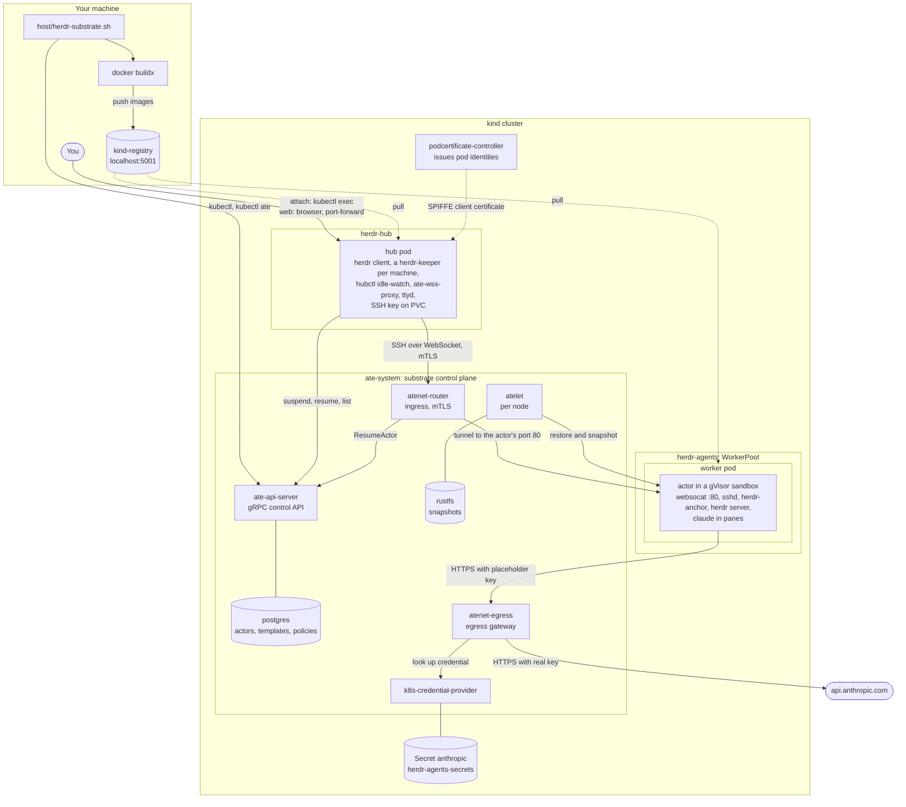

- **Your machine** runs the setup script and Docker. In the quick start, images go to a local registry the
  cluster pulls from.
- **ate-system** is substrate's control plane: the API (state in postgres), the router (the only way into an actor),
  the egress gateway (the only way out), atelet (snapshots, stored in rustfs) and the credential provider.
- **The hub** is an ordinary pod: the herdr client for every actor and the lifecycle controller. A
  `herdr-keeper` carries each of the client's machine connections, so a suspended actor still looks online
  ([Always-on machines](#always-on-machines)). ttyd serves the same herdr TUI to a browser
  ([herdr in the browser](#herdr-in-the-browser)).
- **Each actor** runs in a gVisor sandbox on a worker pod: a herdr server behind sshd behind websocat, with Claude
  Code in its panes. Its `herdr-anchor` holds the hub's session to that server across suspends. Its only egress is `api.anthropic.com`, and the real API key is added on the way out.

Built against herdr **0.9.5**. The quick start tracks substrate's `main` and was tested at commit **4ebd668**
(2026-10-23); the production guides pin substrate release **v0.6.0**.

## Quick start on kind

A complete walkthrough on your own machine, from a clean setup to Claude Code running in a sandboxed actor,
then a suspend/resume round trip. Every command block can be pasted into a terminal as is (bash or zsh). Run
everything from the kit's directory unless a step says otherwise.

It's meant for trying the kit out and for development. For a shared or long-lived installation, follow
[Production on GKE](docs/production-gke.md) or [Production on upstream Kubernetes](docs/production-kubernetes.md)
instead. They prepare the cluster and substrate their own way, then use the same commands as steps 8 to 13 here.

### 1. Prepare Docker

This setup builds several large images and runs a full control plane, and a full Docker disk shows up as
unrelated-looking crashes later. In **Docker Desktop → Settings → Resources**, set:

- **Memory:** 12 GB or more
- **CPUs:** 6 or more
- **Disk usage limit:** 100 GB or more

Then apply, and start from an empty build cache:

```bash
docker builder prune -a -f
```

On Linux with Docker Engine, make sure the disk holding `/var/lib/docker` has 60 GB or more free.

### 2. Install the tools

macOS with Homebrew:

```bash
brew install go kubectl git
```

You also need `python3`, which macOS provides with the Xcode command line tools (`xcode-select --install`).
substrate needs Go 1.27 or newer; with an older Go it downloads the right toolchain automatically. `kind` is
fetched by substrate's own scripts. herdr, websocat and OpenSSH are **not** needed on your machine: they run in
the hub.

Put Go's install directory on your `PATH`, so you can also run `kubectl ate` yourself:

```bash
export PATH="$(go env GOPATH)/bin:$PATH"
```

To make that permanent, add the same line to `~/.zshrc` (or `~/.bashrc`).

### 3. Get the code

Unpack this kit, `cd` into it, then clone substrate next to it (the kit expects `../substrate`):

```bash
git clone https://github.com/agent-substrate/substrate ../substrate
```

### 4. Configure

```bash
cp .env.example .env
```

Add your Anthropic API key. You are prompted for it, so it doesn't end up in your shell history:

```bash
printf 'Anthropic API key: '; read -rs key; printf '\nANTHROPIC_API_KEY=%s\n' "$key" >> .env; unset key
```

On Docker Desktop, select its `docker`-driver builder for image pushes to the kind registry:

```bash
echo 'BUILDX_BUILDER=desktop-linux' >> .env
```

On Linux, use `BUILDX_BUILDER=default` instead. Run `docker buildx ls` to see your builders: the one used
must have the `docker` driver.

### 5. Start clean (only if you ran this kit before)

This deletes the kind cluster and its local registry, and the kit's local state:

```bash
(cd ../substrate && hack/delete-kind-cluster.sh)
```

```bash
rm -rf .state
```

### 6. Check prerequisites

```bash
host/herdr-substrate.sh check
```

It ends with `prerequisites ok`. It stops with a clear message if the builder has the wrong driver, a tool is
missing, or the substrate checkout isn't found.

### 7. Create the cluster and install substrate

```bash
host/herdr-substrate.sh cluster
```

This is the long step: 15–30 minutes the first time, mostly substrate building its Envoy router image. It
creates the kind cluster and registry, installs substrate with the hub's identity on the router's allowlist,
deploys substrate's counter demo (only to reuse its worker image; its workers are scaled to 0), and installs
`kubectl-ate`. It ends by reporting Docker's free disk space.

Check that the control plane is healthy before continuing; every pod in `ate-system` should be fully ready
(`2/2`, `1/1`, …) except `rustfs-bucket-init`, which is `Completed`:

```bash
kubectl -n ate-system get pods
```

### 8. Build the images

```bash
host/herdr-substrate.sh image
```

```bash
host/herdr-substrate.sh hub-image
```

Each ends with a line like `herdr-actor: localhost:5001/herdr-actor@sha256:…`.

If your copy of the kit is on GitHub with its image workflow enabled, you can skip this step and use the
published images instead ([Prebuilt images](#prebuilt-images-from-github)).

### 9. Deploy the hub

```bash
host/herdr-substrate.sh hub
```

Ends with `hub SSH key: ssh-ed25519 …`. The hub generated that key itself; it never leaves the cluster.

### 10. Deploy the agent template

```bash
host/herdr-substrate.sh deploy
```

Creates the worker pool, stores your API key as a Kubernetes Secret, lets the egress gateway read it, creates
the `herdr-agents` atespace with editor rights for the hub, and creates the actor template. It then waits for
the **golden snapshot**, the first boot of the actor image under gVisor (a few minutes), and ends with
`golden snapshot ready`.

### 11. Create an actor and add it to herdr

```bash
host/herdr-substrate.sh actor luna
```

```bash
host/herdr-substrate.sh machine luna
```

`machine` connects from the hub through the router into the actor and saves it as a herdr machine. It ends
with `Saved SSH machine … Remote server is ready.` Repeat both commands with other names for more actors.

### 12. Verify

```bash
host/herdr-substrate.sh status
```

Shows `luna` as `ACTOR_STATE_RUNNING` with a worker pod, and the herdr machine `luna … enabled`.

```bash
host/herdr-substrate.sh verify luna
```

Calls the Anthropic API from inside `luna` with the placeholder key. `OK: luna reached the Anthropic API with
the injected key` proves the egress gateway substitutes the real key.

### 13. Run Claude Code in the actor

```bash
host/herdr-substrate.sh attach
```

In herdr, select **luna** in the sidebar and open a workspace or tab on it (`+`). At the `#` prompt, run:

```bash
claude
```

Claude Code asks once whether to use the API key from the environment: answer **yes**. That key is the
placeholder; the real one never enters the actor. Give it a small task, and watch its state (working, idle)
in herdr's sidebar.

Detach with `ctrl+b` then `q`. Claude and the actor keep running.

Or use the same TUI in your browser:

```bash
host/herdr-substrate.sh web
```

It opens <http://localhost:7681/> (on Linux, or if nothing opens, open it yourself). Each browser tab is its own
herdr client, next to any `attach`. `ctrl+c` in the terminal stops it; the actors keep running. See
[herdr in the browser](#herdr-in-the-browser).

### 14. Suspend and resume

The hub suspends an actor after 5 minutes (`IDLE_SECONDS`) with no working or blocked agent and no input,
even while herdr is attached, and herdr keeps showing the machine online. To see it without waiting, keep herdr
attached in one terminal (step 13). In a second terminal, from the kit's directory:

```bash
host/herdr-substrate.sh suspend luna
```

```bash
host/herdr-substrate.sh status
```

`luna` is now `ACTOR_STATE_SUSPENDED` with no worker pod. Its memory, including the running Claude session, is in
a snapshot. The herdr machine is still `enabled`, and the keeper line reads `keeper luna (…): parked`. In the
herdr terminal, luna still shows `●`, online.

Now type into a pane on luna. The keystroke wakes it: the keeper reconnects, the router resumes the actor, and the
keystroke arrives a moment later in the same session, with Claude where you left it. `status` shows it
`ACTOR_STATE_RUNNING` and the keeper `awake` again. To wake an actor without typing, run
`host/herdr-substrate.sh resume luna`.

To watch the hub's automatic decisions (Ctrl-C to stop):

```bash
host/herdr-substrate.sh logs
```

### 15. Tear down

Remove a single actor, including its snapshot:

```bash
host/herdr-substrate.sh delete luna
```

Remove all actors, the template, hub and namespaces, keeping the cluster:

```bash
host/herdr-substrate.sh down
```

Or delete everything, including the cluster and registry:

```bash
(cd ../substrate && hack/delete-kind-cluster.sh)
```

### One-shot alternative

Steps 6–11 in one command, creating actors `luna`, `mars` and `orion` (pass names to choose your own):

```bash
host/herdr-substrate.sh up
```

The step-by-step path above is easier to diagnose the first time.

## How it works

This applies to every flavour. The production guides change where components run and where state is kept,
not how the hub, the actors and substrate interact. Where a diagram shows a quick-start detail (the local
registry, a kind node), the guides name what replaces it.

### Life of an actor

From `actor luna` to Claude's first request, and back to sleep. The numbers match the steps below.

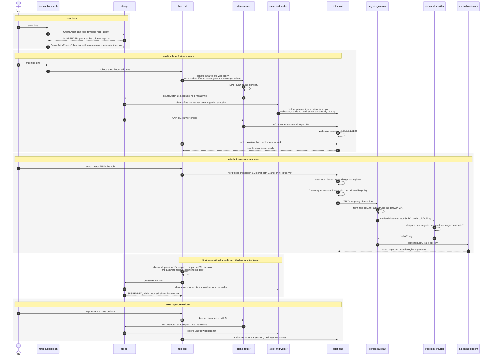

- **Creation (1–4)** only writes records: a new actor is `SUSPENDED` and points at the template's golden snapshot,
  so it uses no worker until something connects.
- **First connection (5–16).** The hub's SSH connection reaches the router, which checks the hub's identity and
  holds the request while ate-api claims a worker and atelet restores the golden snapshot. sshd, websocat and the
  herdr server were running when the snapshot was taken, so they are running again immediately.
- **First Claude request (17–27).** The actor can resolve and reach only `api.anthropic.com`. The egress gateway
  terminates its TLS (the actor trusts the gateway's CA), looks up the credential the egress policy names, and
  replaces the placeholder `x-api-key` with the real one.
- **Back to sleep (28–31).** After `IDLE_SECONDS` without a working or blocked agent or any input, the hub parks
  the keeper and suspends the actor. herdr keeps showing it online: the keeper answers its health checks.
- **Wake on demand (32–36).** Input on luna makes the keeper reconnect, and the router resumes the actor from its
  own snapshot. The anchor never lost the session, so the keystroke simply arrives a moment later.

### Two roles, two lifecycles

| | Server actors (the agents) | Hub pod (herdr client + controller) |
|---|---|---|
| Runs as | substrate actor, gVisor sandbox | ordinary Kubernetes Deployment, 1 replica |
| Count | many; fewer workers than actors | one |
| Busy when | an agent is working | always, but tiny: a 30 s poll loop |
| Sleeps | suspended after `IDLE_SECONDS` with no working or blocked agent and no input, even with a client attached | doesn't; scale it to 0 if you like, its state is on its volume |
| Wakes | input or a request from a herdr client, any other connection through the router, or `resume` | `attach`, `web` / `kubectl exec` |
| State | agent sessions, in memory snapshots | herdr machine list, SSH key, known_hosts, idle timers (1 GiB PVC) |
| Holds | nothing privileged; a placeholder API key | the SSH key to every actor, atespace editor on ate-api, a router identity |

#### Why the client is a pod, not an actor

- **Actors can't open streams.** Substrate's egress allows HTTP(S) requests only; WebSocket, `CONNECT` and any
  other TCP are blocked (`docs/egress-traffic.md`). Herdr's machine connections are long-lived SSH streams, so a
  client actor could never reach the server actors.
- **The client is the trust anchor.** It holds keys to every actor and ate-api access. Substrate treats actors as
  untrusted and keeps credentials and control-plane access out of them.
- **The router admits only allowlisted identities.** The Envoy router requires `--ingress-allowed-spiffe-ids` and
  accepts only clients with an mTLS certificate carrying an allowlisted SPIFFE ID. A pod gets one from substrate's
  pod-identity signer; a laptop with a port-forward has none.
- **The lifecycles are coupled through the client.** An attached herdr client keeps every machine connected, and
  any connection through the router resumes its actor. So whatever suspends actors must also control the client's
  connections. In the hub, `hubctl` parks the keepers that carry them before it suspends.

### Lifecycle

`hubctl idle-watch` runs as a service in the hub. Every `POLL_SECONDS` it looks at the actors substrate reports
as running, never at suspended ones, since polling would wake them. For each one it asks two questions:

- **Agents:** any agent `working` or `blocked`? It asks with `herdr --machine <actor> agent list`.
- **Input:** has anyone typed into, or opened, the machine in an attached herdr client? The keepers report this.

An actor with neither for `IDLE_SECONDS` is suspended:

1. Its keepers park. Each one waits until everything it sent is acknowledged and the actor has gone quiet, then
   drops its SSH session. Input arriving meanwhile cancels the suspend.
2. Leftover tunnels are cut. herdr's own SSH master, used for its probes, would otherwise keep sending keepalives
   for up to 10 minutes (`ControlPersist=600`).
3. `kubectl-ate suspend actor` runs, as `system:serviceaccount:herdr-hub:herdr-hub` (atespace editor).

Nothing needs resuming by hand: the next keystroke or request in a client wakes the actor. `resume <actor>` still
wakes one explicitly, and reconnects attached clients straight away.

### Always-on machines

herdr's client pings every connected machine after 5 seconds of quiet, and gives up after 10 more. A suspended
actor can't answer, so a plain connection would show the machine as reconnecting, and every reconnect would wake
the actor. Two small programs keep the connection's other end alive instead:

- **`herdr-keeper`, in the hub.** herdr starts `ssh <machine> '… herdr remote-client-bridge'` for each saved
  machine. In the hub, `ssh` is a wrapper that hands those bridges, for `ate-*` machines only, to a keeper.
  - **Awake:** the keeper relays herdr's frames over a real SSH session.
  - **Parked:** it answers herdr's health pings itself, so the machine stays online.
  - **Held frames:** focus, theme and resize frames wait for the next wake, latest only.
  - **Waking:** anything else, such as a keystroke, opening the machine, or a request, wakes the actor by
    reconnecting through the router.
- **`herdr-anchor`, in the actor.** It runs the bridge to the herdr server and keeps it while the SSH session is
  gone. The anchor, the bridge and their connection to the server are all in the actor's memory snapshot, so after
  a resume they carry on. Both sides then replay what the other hasn't received, so the herdr server never sees a
  disconnect.

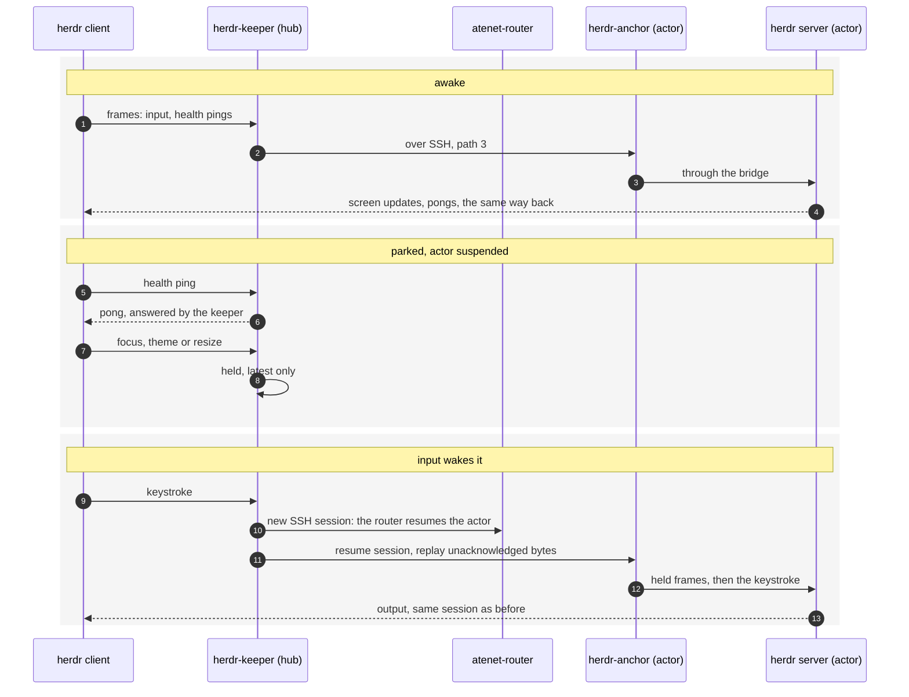

The keeper depends only on herdr's endpoint protocol, which herdr's source declares a stable contract: length-prefixed
frames, frozen message tags, and a named health ping and pong. If the bridge command doesn't look as expected, or
the actor's image has no `herdr-anchor`, the keeper relays plainly and refuses to park. That machine then works
like plain herdr, and hubctl won't suspend its actor while a client is attached.


#### Actor states

The herdr machine stays enabled and shows online in every state; only substrate's state changes.

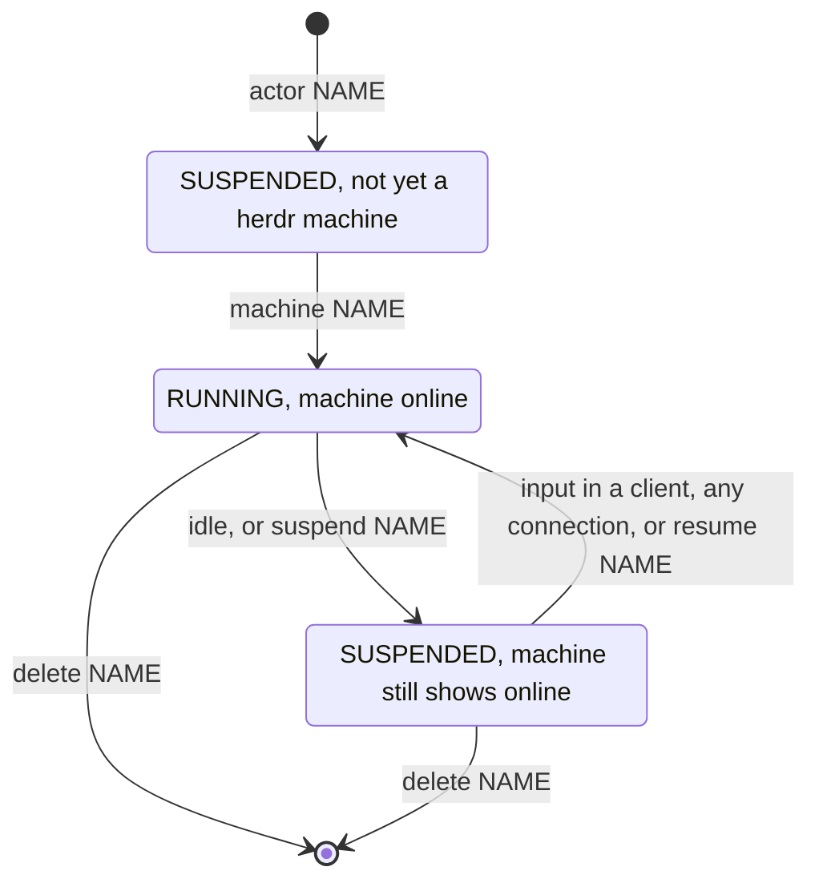

- `actor NAME` creates the actor suspended, from the golden snapshot. `machine NAME`'s first ssh goes through the
  router, which resumes it, and then registers it with herdr.
- *Idle or `suspend NAME`* parks the keepers, cuts leftover tunnels, then calls `SuspendActor`; the snapshot
  uploads in the background. Input or a working or blocked agent resets the idle timer.
- *Any connection* through the router wakes a suspended actor: input in a client, but also `verify`, `debug`, or
  herdr's probes when a client starts. Whatever woke it, the idle bridge suspends it again after `IDLE_SECONDS`.
- `delete NAME` works from any state.

### herdr in the browser

The hub runs [ttyd](https://github.com/tsl0922/ttyd), a small web terminal that serves the herdr TUI to a
browser. Each tab is its own herdr client, started for that tab and ended when it closes, just like each
`attach`. All clients share the hub's herdr server: the same machines, workspaces and panes, and a command typed
in one shows up in the others.

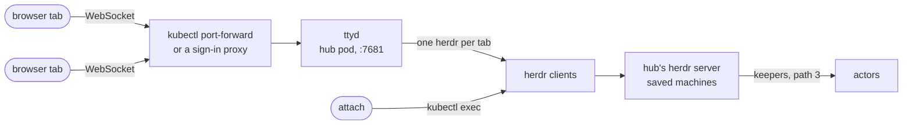

- **Who can reach it.** ttyd listens only on the pod's loopback. The `web` command reaches it with
  `kubectl port-forward` as your kubeconfig identity, so it needs the same kind of access as `attach`
  (`pods/portforward` instead of `pods/exec` in `herdr-hub`). Nothing else in the cluster or on the network can
  connect, and ttyd refuses WebSockets opened from another site's pages.
- **A shared link.** For a URL operators open without kubectl, the production guides put ttyd behind sign-in:
  [IAP on GKE](docs/production-gke.md#14-browser-access) and
  [oauth2-proxy on upstream Kubernetes](docs/production-kubernetes.md#14-browser-access). Anyone who gets
  through that sign-in controls every actor, as with `attach`.
- **Always on, here too.** Browser clients go through the same keepers. A suspended actor shows online, and
  opening the page or typing wakes it.
- **Copy, paste and right-click.** The hub serves ttyd's page with a small script added (`hub/herdr-web.js`), so
  the browser behaves like a desktop terminal running herdr:
  - **Copy:** select with the mouse as in herdr anywhere. herdr copies the selection (as OSC 52), the script puts
    it on your clipboard, and "Copied" shows in the corner.
  - **Paste:** `cmd+v` on macOS, `ctrl+v` or `ctrl+shift+v` elsewhere. It arrives as one paste, not as typing.
  - **Right-click** opens herdr's menu; the browser's own menu stays out of the way.

  Clipboard access needs a secure page: `http://localhost` (as `web` uses) or `https`. Tested in Chromium. Other
  browsers may refuse a copy that doesn't follow a click closely enough (Safari is the strictest); the corner then
  says the browser blocked it.
- **Keys.** Keys go to herdr, including its `ctrl+b` prefix, except the ones the browser keeps for itself, such
  as `ctrl+w` and `ctrl+t`.
- **Dropped connections.** ttyd pings every 5 seconds, which keeps proxies from closing an idle tab. If the
  connection drops anyway (laptop asleep, `web` stopped), the page offers to reconnect, which starts a fresh
  herdr client; nothing is lost on the hub or the actors.
- **Turning it off.** `kubectl -n herdr-hub set env deployment/herdr-hub HUB_WEB=false` runs the hub without
  the web terminal.

### Trust and identity

Every credential in the system, who holds it, and who checks it.

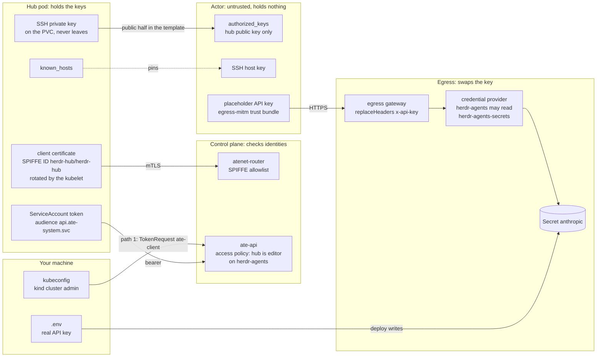

- **The hub holds the keys.** Its router identity (a short-lived certificate from substrate's pod-identity signer),
  its ate-api token and the SSH private key all live in the hub pod and never leave the cluster.
- **The control plane checks identities.** The router admits only the hub's SPIFFE ID; ate-api grants the hub
  editor rights on `herdr-agents` and nothing else. In the quick start, your machine reaches ate-api as the
  bootstrap owner, via path 1. In production you act as `herdr-operator`, which owns only `herdr-agents`.
- **Actors hold nothing worth stealing.** An actor has the hub's *public* key, its own host key (pinned by the hub
  on first connect) and a placeholder API key.
- **The real API key stays in a Secret.** The egress gateway decrypts the actor's HTTPS (the actor trusts its
  `egress-mitm` bundle), asks the credential provider for the key and replaces the `x-api-key` header.

### Network and ports

Every listener, and which hop crosses which port.

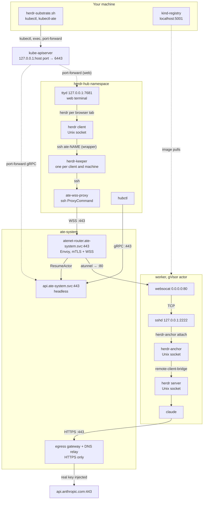

- In the quick start, nothing listens on your machine except the kind registry (`localhost:5001`),
  kube-apiserver's mapped port and, while `web` runs, its port-forward on `127.0.0.1:7681`. In production,
  only that port-forward.
- In the hub, ttyd listens on the pod's loopback, so only `kubectl port-forward` reaches it. The production
  guides' shared link moves it to the pod IP, behind a NetworkPolicy and a sign-in proxy.
- Inside an actor only websocat listens on all interfaces (port 80, the one port the router forwards). sshd is on
  loopback; herdr and herdr-anchor use Unix sockets.
- Actor egress is HTTPS only, through the gateway. The DNS relay answers NXDOMAIN for hosts outside the egress
  policy, so an actor can't even resolve names it isn't allowed to reach.

## Commands

`host/herdr-substrate.sh <command>`. Every step is idempotent and can be re-run.

The same commands drive every flavour. `cluster` and `up` exist only in the quick start, where they create the
kind cluster and install substrate. The production guides set up the cluster and substrate themselves, then point
the script at it through `.env` ([Configuration](#configuration)). The script's disk check and builder check
only apply to the kind registry.

| Command | What it does |
|---|---|
| `check` | tools, substrate checkout, Docker reachable, buildx builder driver, free disk space (once the cluster exists) |
| `cluster` | substrate's `create-kind-cluster.sh`; `install-ate-kind.sh deploy ate-system` with the k8s.io credential provider and the hub in `ATE_INGRESS_ALLOWED_SPIFFE_IDS`; `deploy demo counter` (scaled to 0 workers, used for its worker image); `go install ./cmd/kubectl-ate` |
| `image` | builds `actor/`, pushes to `REGISTRY` (`localhost:5001`), records the digest (templates must be digest-pinned). Not needed with a prebuilt `ACTOR_IMAGE` |
| `hub-image` | cross-builds `kubectl-ate` from your substrate checkout into `hub/bin/linux-<arch>/`, builds and pushes `hub/`. Not needed with a prebuilt `HUB_IMAGE` |
| `hub` | applies `manifests/hub.yaml.tmpl`; waits for the hub's SSH key |
| `deploy` | WorkerPool, Anthropic Secret + credential-provider grant, atespace, hub access policy, ActorTemplate trusting the hub key; waits for the golden snapshot |
| `actor <name>` | creates the actor and its egress policy |
| `machine <name>` | `hubctl add <name>` in the hub: pins the host key, `herdr machine add` |
| `delete <name>` | removes one actor: its herdr machine (first, so nothing reconnects and resumes it), its egress policy, the actor and its snapshot |
| `verify <name>` | calls the Anthropic API from inside the actor with the placeholder key |
| `attach` | herdr TUI in the hub, sized to your terminal |
| `web` | the same TUI in your browser: port-forward to the hub's ttyd, opens `http://localhost:7681/` (`WEB_PORT`) |
| `suspend <name>` / `resume <name>` | `hubctl` in the hub (see [Lifecycle](#lifecycle)); resuming by hand is optional, input wakes actors |
| `status` | actors and herdr machines, as the hub sees them |
| `logs` | follows the hub: idle-bridge decisions |
| `debug <name>` | actor state and logs, hub logs, `ssh -vvv` from the hub |
| `down` | deletes actors, template, access policy, atespace, hub and namespaces; keeps the cluster |
| `up [names…]` | `cluster` through `machine`, for the given actors (default `luna mars orion`) |


### Three paths into the cluster

Every command reaches the cluster in one of three ways.

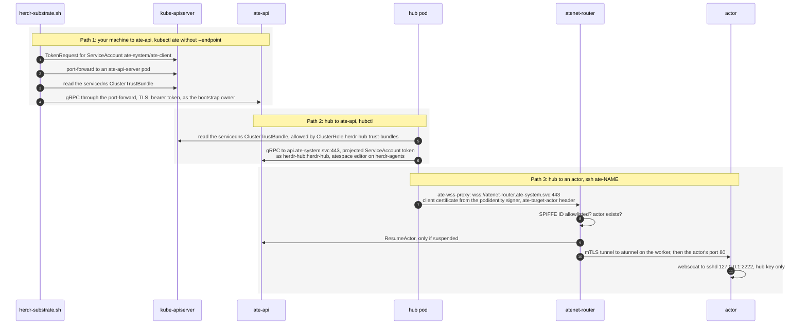

- **Path 1** is how *you* talk to ate-api. `kubectl ate` mints a token for substrate's `ate-client` ServiceAccount,
  which a quick-start install makes a bootstrap owner, and tunnels to the API through a port-forward. The
  production guides set `ATE_CLIENT_SERVICE_ACCOUNT=herdr-operator`, so the same path runs as an identity that
  owns only the herdr atespace.
- **Path 2** is how the *hub* talks to ate-api: directly, inside the cluster, with its own projected token and
  only atespace-editor rights on `herdr-agents`.
- **Path 3** is the only way into an actor. The router admits only allowlisted SPIFFE identities, so only the hub
  can use it; your machine never connects to an actor directly.

### What each command uses

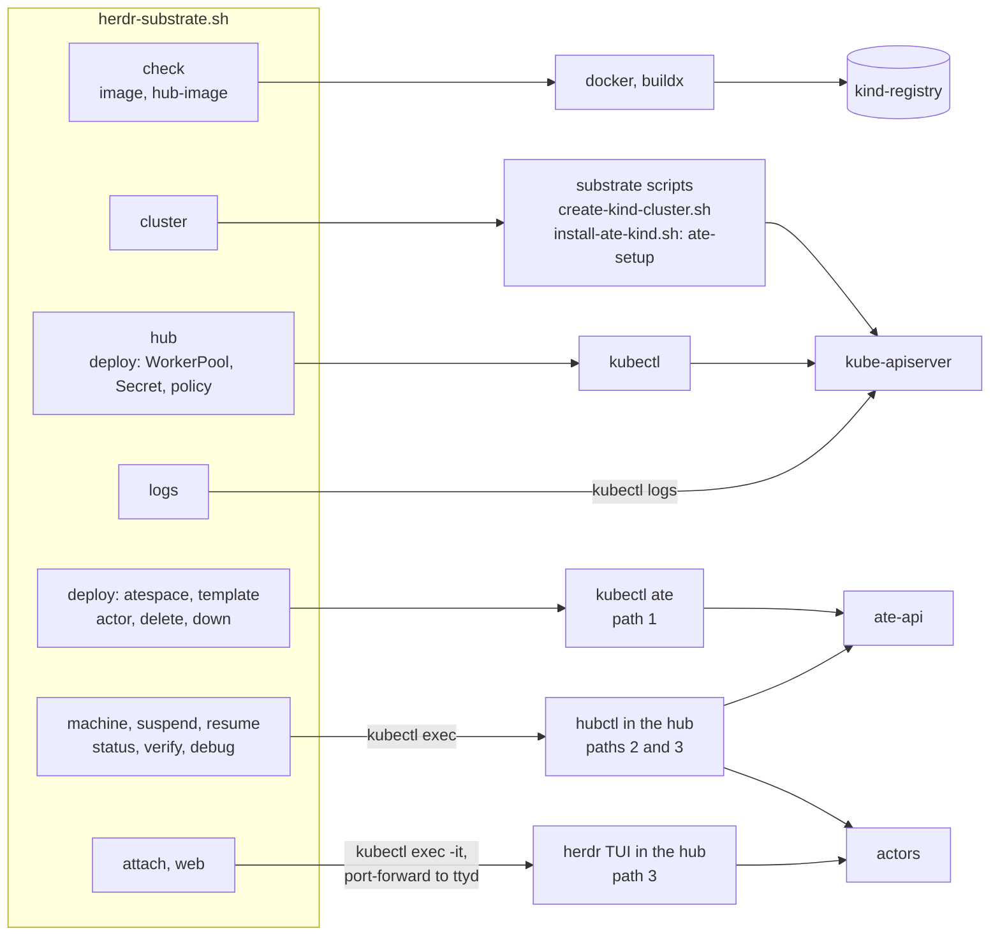

#### `check`

Read-only. Checks the tools on your `PATH`, the substrate checkout, that Docker answers, that the active buildx
builder uses the `docker` driver (`docker buildx inspect`), and, once the cluster exists, the free space on
Docker's disk (`df` in the kind node).

#### `cluster`

Runs substrate's own kind tooling; `install-ate-kind.sh` is a wrapper around substrate's installer, `ate-setup`.

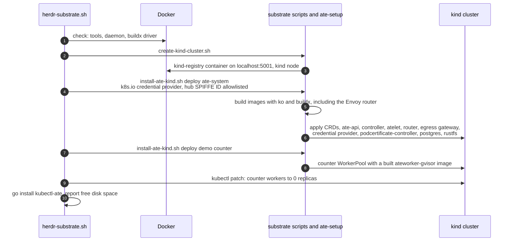

The router allowlist is fixed at install time, which is why this step, not `hub`, puts the hub's SPIFFE ID on
it. Re-running `cluster` recreates the cluster from scratch.

#### `image` and `hub-image`

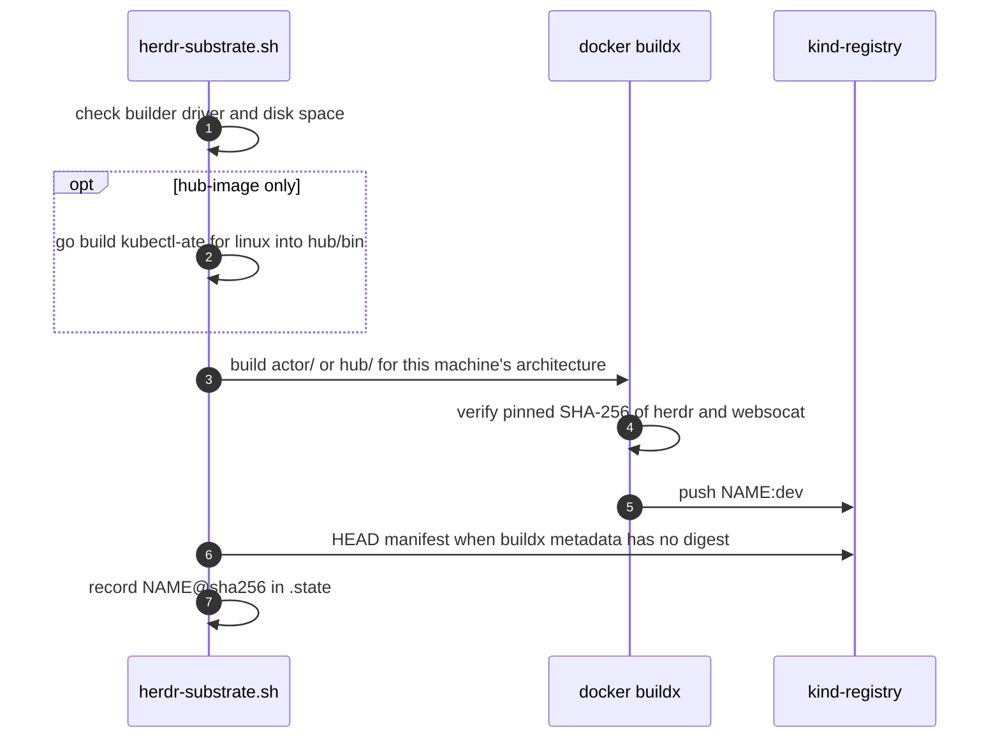

Templates and Deployments reference images by digest, so the digest is recorded in `.state/` for `hub` and
`deploy`. `hub-image` builds `kubectl-ate` from your substrate checkout, so the hub's client matches the cluster.

#### `hub`

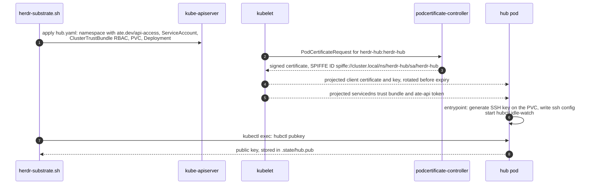

Uses kubectl only. The hub's identity comes entirely from Kubernetes: its ServiceAccount gives it a SPIFFE
certificate for the router and a token for ate-api, and its namespace label lets ate-system's NetworkPolicy admit
it. The SSH private key is created inside the pod and never leaves its volume.

#### `deploy`

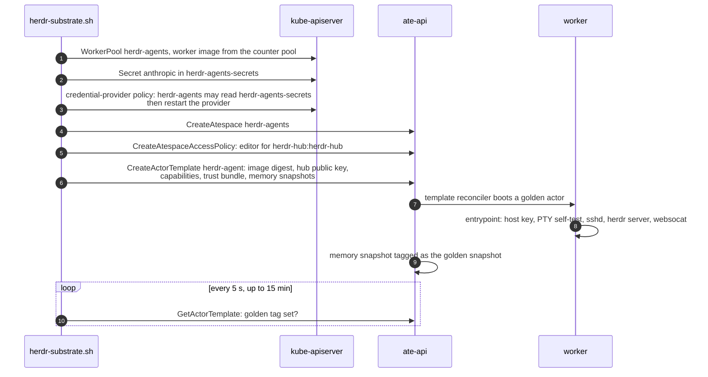

Kubernetes objects go through kubectl; substrate objects (atespace, access policy, template) through path 1.
Each step checks what already exists, so re-running is safe; templates are immutable, so changing the image or
key means `down` and `deploy` again.

#### `actor <name>`

Path 1 only: `CreateActor`, then `CreateActorEgressPolicy` allowing `api.anthropic.com` with key injection
(steps 1–4 of [Life of an actor](#life-of-an-actor)). The actor stays suspended and uses no worker until something
connects.

#### `machine <name>`

`kubectl exec` into the hub, which runs `hubctl add`: a first `ssh ate-<name>` over path 3, which resumes the
actor and pins its host key, then `herdr machine add`, which checks the actor's herdr server and saves it. These
are steps 5–16 of [Life of an actor](#life-of-an-actor).

#### `attach`

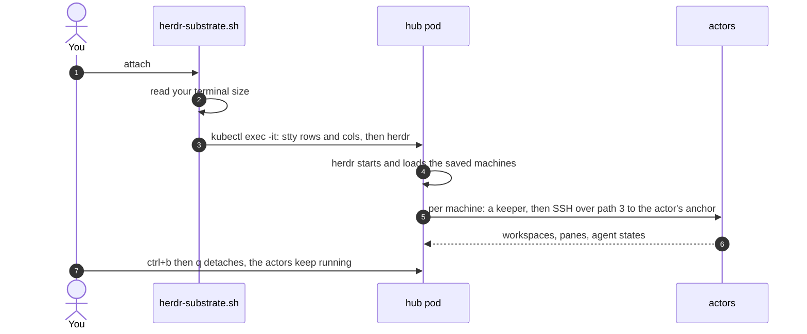

herdr connects only while a client is attached. While it is, idle actors are still suspended, and their machines
still show online ([Always-on machines](#always-on-machines)).

#### `web`

The same as `attach`, in a browser tab. See [herdr in the browser](#herdr-in-the-browser).

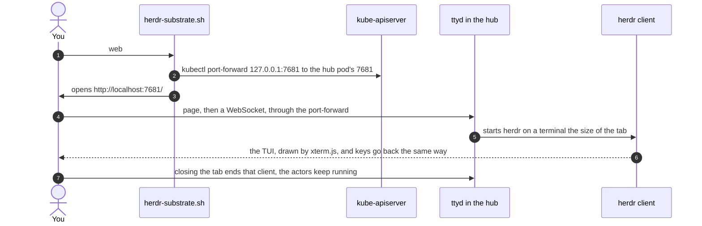

#### `verify <name>`

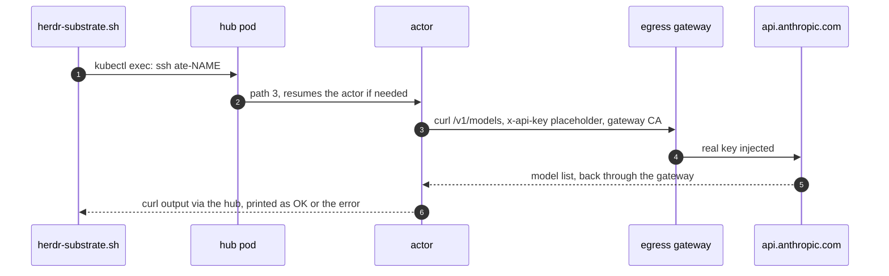

The same path Claude's requests take, without Claude: it separates network and credential problems from
Claude Code problems.

#### `suspend <name>` and `resume <name>`

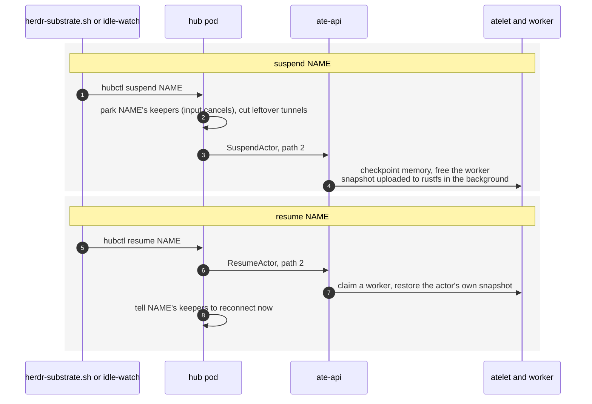

Both run in the hub, because the keepers live there and the order matters: they must be parked before the
suspend. `hubctl idle-watch` runs the same suspend automatically (see [Lifecycle](#lifecycle)). `suspend` refuses
while someone is typing, or when a keeper can't park; `suspend NAME --force` (in the hub: `hubctl suspend NAME
--force`) suspends anyway, and the next input wakes the actor again.

#### `delete <name>`

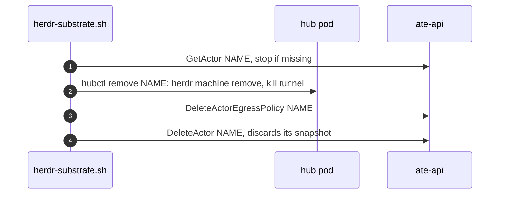

#### `status`, `logs` and `debug <name>`

- `status`: `hubctl status` in the hub, so it shows the hub's view: actors over path 2 and the hub's herdr machines.
- `logs`: `kubectl logs -f` of the hub, where `hubctl idle-watch` logs its decisions.
- `debug <name>`: the actor's state and logs (path 1), the hub's logs, and `ssh -vvv` from the hub (path 3), which
  shows where along path 3 a connection fails.

#### `down` and `up`

- `down` runs the `delete` sequence for every actor, then deletes the template, access policy and atespace (path
  1) and the namespaces and RBAC (kubectl). The cluster, and substrate in it, stay.
- `up` runs `cluster`, `image`, `hub-image`, `hub`, `deploy`, then `actor` and `machine` for each name.

## Prebuilt images from GitHub

`.github/workflows/images.yml` builds both of the kit's images for `linux/amd64` and `linux/arm64`, and publishes
them to GitHub Container Registry. It runs when the kit is the root of a GitHub repository with Actions enabled.

- **`ghcr.io/<owner>/herdr-actor`** has no substrate dependency, so one build serves every cluster.
- **`ghcr.io/<owner>/herdr-hub`** is built once per substrate release. Its `kubectl-ate` has to come from the
  same release as the cluster, because substrate's API changes between releases. Each build's tags end in
  `-substrate-<release>`.

| Event | `herdr-actor` tags | `herdr-hub` tags |
|---|---|---|
| Push to `main` | `edge`, `sha-<commit>` | `edge-substrate-v0.6.0`, `sha-<commit>-substrate-v0.6.0` |
| Tag `v1.2.3` | `1.2.3`, `sha-<commit>` | `1.2.3-substrate-v0.6.0`, `sha-<commit>-substrate-v0.6.0` |
| Pull request | built, not pushed | built, not pushed |
| Run workflow (manual) | as for the branch or tag it runs on; input `claude_code_version` overrides the variable below | same; input `substrate_refs` overrides the variable below |

Each run's summary lists the digest-pinned references, ready to paste into `.env`. In a public repository, every
pushed image also gets a signed SLSA build-provenance attestation. Check one with:

```bash
gh attestation verify oci://ghcr.io/OWNER/herdr-actor:1.2.3 --owner OWNER
```

**Setting it up.**

1. Push the kit to a GitHub repository, with the kit's files at the root.
2. Optionally, set two repository variables (*Settings → Secrets and variables → Actions → Variables*):
   - `CLAUDE_CODE_VERSION` pins the Claude Code release in `herdr-actor`. Without it, each build takes the
     latest release and records it in the image's labels and the run summary.
   - `SUBSTRATE_REFS` is a comma-separated list of substrate releases or commits to build `herdr-hub` for. The
     default is `v0.6.0`.
3. After the first run, open each package (`herdr-actor`, `herdr-hub`) under your profile's or organization's
   *Packages*, and set its visibility to **public**. The images carry the repository in their labels, so
   GitHub shows them linked to it. GitHub creates new packages as private, and
   cluster nodes pull these images without credentials. atelet pulls actor images anonymously unless a kubelet
   credential provider is configured, and the manifests carry no image pull secrets.

**Using them.** Set the images in `.env`, by tag or by digest. The script resolves a tag to its digest when it
uses it, because templates must be digest-pinned. Then skip `image` and `hub-image`:

```bash
cat >> .env <<'EOF'
ACTOR_IMAGE=ghcr.io/OWNER/herdr-actor:1.2.3
HUB_IMAGE=ghcr.io/OWNER/herdr-hub:1.2.3-substrate-v0.6.0
EOF
```

Pick the `herdr-hub` build whose substrate release matches the cluster's:

- **Quick start:** substrate is checked out from `main`. Either keep building the hub with `hub-image`, or check
  out the same substrate commit you added to `SUBSTRATE_REFS` before running `cluster`.
- **Production:** the guides pin `v0.6.0`, the workflow's default. They copy the images into your own registry
  instead of pulling from GitHub; see their step 10.

## Configuration

Set in `.env` (see `.env.example`) or the environment. The quick start sets `ANTHROPIC_API_KEY` and, on Docker
Desktop, `BUILDX_BUILDER` (step 4); everything else has a working default.

| Variable | Default | Meaning |
|---|---|---|
| `ANTHROPIC_API_KEY` | — (required for `deploy`) | stored in a Secret; injected by the egress gateway |
| `SUBSTRATE_DIR` | `../substrate` | substrate checkout |
| `BUILDX_BUILDER` | your current builder | must use the `docker` driver: `desktop-linux` on Docker Desktop, `default` on Linux |
| `KIND_CLUSTER_NAME` | `kind` | |
| `ATESPACE` | `herdr-agents` | substrate atespace for the actors |
| `K8S_NAMESPACE` | `herdr-agents` | namespace of the actors' WorkerPool |
| `SECRETS_NAMESPACE` | `herdr-agents-secrets` | namespace of the API key Secret |
| `HUB_NAMESPACE` | `herdr-hub` | namespace of the hub; part of its SPIFFE ID |
| `WORKER_REPLICAS` | `2` | worker pods; fewer than actors is the point |
| `HERDR_VERSION` | `0.9.5` | must match the checksums pinned in the Dockerfiles |
| `IDLE_SECONDS` | `300` | idle time before the hub suspends an actor (applied by `hub`) |
| `POLL_SECONDS` | `30` | idle-bridge poll interval (applied by `hub`) |
| `ATE_INGRESS_ALLOWED_SPIFFE_IDS` | — | extra router clients; the hub's ID is always added |
| `WEB_PORT` | `7681` | local port `web` forwards from |
| `WEB_OPEN` | `true` | `web` opens your browser; `false` only prints the URL |

The production guides add these. Their defaults are the quick start's.

| Variable | Default | Meaning |
|---|---|---|
| `KUBE_CONTEXT` | `kind-$KIND_CLUSTER_NAME` | kubeconfig context every command uses |
| `REGISTRY` | `localhost:5001` | where `image` and `hub-image` push; anything but localhost skips the kind-only builder and disk checks |
| `PLATFORM` | this machine's, e.g. `linux/arm64` | image platform; the cluster nodes' platform, e.g. `linux/amd64` |
| `CLAUDE_CODE_VERSION` | the Dockerfile's (`latest`) | Claude Code release baked into the actor image |
| `WORKER_IMAGE` | borrowed from the counter demo | digest-pinned `ateworker-gvisor` image for the WorkerPool |
| `WORKER_NODE_SELECTOR` | `{}` | YAML flow map selecting the workers' nodes, e.g. `{"ate.dev/sandboxClass": "gvisor"}` |
| `CREDENTIAL_PROVIDER` | `k8s.io` | the cluster's egress credential provider; any other value makes `deploy` skip the Secret and its grant |
| `CREDENTIAL_URI` | `ate-secret://k8s.io/default/$SECRETS_NAMESPACE/anthropic/api-key` | key reference written into each actor's egress policy |
| `ATE_CLIENT_SERVICE_ACCOUNT` | — (substrate: `ate-client`) | read by kubectl-ate: the ServiceAccount in `ate-system` it acts as |
| `ACTOR_IMAGE` | — (what `image` built) | prebuilt actor image, by tag or digest ([Prebuilt images](#prebuilt-images-from-github)) |
| `HUB_IMAGE` | — (what `hub-image` built) | prebuilt hub image; its substrate release must match the cluster's |
| `HUB_WEB_ADDR` | `127.0.0.1` | where the hub's ttyd listens (applied by `hub`); `0.0.0.0` for a sign-in proxy in front, as in each guide's step 14 |
| `HUB_WEB_AUTH_HEADER` | — | ttyd refuses requests without this header (applied by `hub`); the guides' oauth2-proxy sets `X-Forwarded-Email` |

## Disk and resources (quick start)

The kind node's filesystem is Docker's disk. Postgres, the snapshot store (rustfs), Prometheus' metrics, pulled
images and your builds all land there, and the 1 GiB volume claims are not real limits. When it fills up,
postgres crash-loops ("No space left on device"), the API server goes 1/2, and everything that depends on it
fails in ways that look unrelated.

- Once the cluster exists, `check`, `cluster`, `image` and `hub-image` report free space and warn below 20 GB.
- `docker builder prune -a -f` frees the build cache, which is usually the largest consumer.
- Prometheus grows continuously. Restarting it empties its store, which loses nothing you need:
  `kubectl -n otel-system delete pod -l app=prometheus`.
- After freeing space, restart crashed pods instead of waiting out their back-off:
  `kubectl -n ate-system delete pod postgres-0` and `kubectl -n ate-system delete pod -l app=rustfs`.

## Files

| Path | Purpose |
|---|---|
| `actor/Dockerfile`, `actor/entrypoint.sh`, `actor/sshd_config`, `actor/herdr-config.toml` | the agent actor: Claude Code and a herdr server behind sshd behind websocat :80; pinned binaries; Claude onboarding pre-completed |
| `hub/Dockerfile`, `hub/entrypoint.sh`, `hub/herdr-config.toml` | the hub image; generates its SSH key and ssh config on its volume, runs the idle bridge and the web terminal (ttyd); takes `kubectl-ate` from `hub/bin/linux-<arch>/` |
| `hub/herdr-web.js`, `hub/herdr-web-index` | the web terminal's copy, paste and right-click handling, and the script that adds it to ttyd's page when the hub starts |
| `hub/ate-wss-proxy` | SSH ProxyCommand: mTLS WebSocket to atenet-router with the pod's SPIFFE certificate |
| `hub/hubctl` | add/remove machines, suspend/resume (parking keepers), idle bridge, `ate` passthrough |
| `hub/herdr-keeper`, `hub/ssh` | keeps each machine connection looking online while its actor is suspended; the `ssh` wrapper hands herdr's bridges to it |
| `actor/herdr-anchor` | holds the hub's herdr session in the actor across suspends, replays after reconnects |
| `manifests/hub.yaml.tmpl` | hub namespace (`ate.dev/api-access=true`), ServiceAccount, ClusterTrustBundle read RBAC, PVC, Deployment with projected identity, trust and token volumes |
| `manifests/hub-access-policy.yaml.tmpl` | atespace editor for the hub, nothing global |
| `manifests/workerpool.yaml.tmpl` | gVisor WorkerPool for the actors; node selector from `WORKER_NODE_SELECTOR` |
| `manifests/actor-template.yaml.tmpl` | the ActorTemplate (protojson for `kubectl ate create actor-template`) |
| `manifests/egress-policy.yaml.tmpl` | per actor: only `api.anthropic.com`, with `x-api-key` injection from `CREDENTIAL_URI` |
| `manifests/anthropic-secret.yaml.tmpl` | the real key, in its own namespace |
| `host/herdr-substrate.sh` | every command above |
| `docs/production-gke.md`, `docs/production-kubernetes.md` | production deployments on GKE and on upstream Kubernetes |
| `.github/workflows/images.yml` | builds and publishes `herdr-actor` and `herdr-hub` (per substrate release) to GHCR, multi-arch, with provenance |
| `test/` | `keeper-test.py`, `local-bridge-test.sh`, `hub-path-test.sh`, `web-client.js` (drives the web terminal in Chromium), `fake_router.py`, `ssh_config.tmpl`, `Dockerfile.local` |
| `.state/` | created by the script: image digests, the hub's public key, rendered manifests. Per checkout; safe to delete |

## Verification status

**Quick start, on a real kind cluster** (Docker Desktop, macOS arm64, 2026-10-25):

| Check | Result |
|---|---|
| substrate install with the hub on the router allowlist | pass |
| Golden snapshot of the actor image under gVisor | pass |
| PTYs under gVisor (herdr panes, Claude Code's TUI) | pass |
| Hub pod certificate → router mTLS → actor; `machine add` | pass |
| Hub → ate-api authentication and atespace-editor authorization | pass |
| Default-deny egress (anything but `api.anthropic.com` → `ENOTFOUND`) | pass |
| Claude Code starts in the actor (with onboarding pre-completed) | pass |
| Credential injection (`verify`), suspend/resume round trip, automatic idle suspend | covered by the walkthrough, steps 12–14 |

**Without a cluster** (build environment, 2026-10-23):

| Check | How | Result |
|---|---|---|
| ActorTemplate, EgressPolicy, hub AccessPolicy | substrate's own `apivalidation` create-request validators | 0 errors |
| Hub Deployment, RBAC, PVC, projected `podCertificate`/`clusterTrustBundle`/token volumes | `kubeconform -strict`, Kubernetes 1.34 schemas | valid |
| Actor image under substrate's exact capability set | `test/local-bridge-test.sh` | 8/8 |
| The 4 added capabilities are required | same, `NEGATIVE=1` → `chroot("/run/sshd"): Operation not permitted` | confirmed |
| Hub → mTLS router → actor; SPIFFE allowlist and `ate-target-actor` enforced | `test/hub-path-test.sh` with `test/fake_router.py` | 13/13 |
| Always-on: real herdr TUI attached; idle agent → keeper parked → actor suspended, machine stays enabled | same, suspend emulated with `docker pause` | pass |
| Suspended: luna shows online for 45 s of health checks; nothing reaches the router; a resize doesn't wake it | same | pass |
| A typed command wakes it: router resumes the actor, keeper rejoins the same session, output on screen | same | container up in 0.16 s, session resumed in 0.38 s |
| Keeper and anchor: local pongs, held frames (latest only), 7 MB intact across a forced reconnect, park refused during input, lost session reported, plain relay for images without the anchor | `test/keeper-test.py` | 23/23 |
| Web terminal: ttyd in the hub listens on loopback only; headless Chromium types a command that runs on luna and shows in the tmux client too; closing the tab ends its herdr client; a new tab on a suspended luna wakes it | `test/hub-path-test.sh` steps 1, 10, 11 (31/31 in all) | pass |
| Web terminal: a mouse selection reaches the clipboard, right-click opens herdr's menu with the browser's suppressed, `ctrl+v` pastes into luna. ttyd's own page does none of the three | same, step 12; the same checks against ttyd's default page | pass; default page fails all three |
| `web`: forwards, checks the page answers, stops the port-forward on exit; reports a proxy-only hub (407) clearly | script run against a stub kubectl and ttyd | pass |
| Scripts | `shellcheck` | clean |

**Production guides** (build environment, 2026-10-25). They have not yet run against a real GKE or upstream
cluster. What was checked offline:

| Check | How | Result |
|---|---|---|
| Upstream overlay builds on v0.6.0's manifests, alone and with `--cordon-control-plane`; changes only what it claims | `kustomize build`, diffed against the GKE base | pass |
| Both install documents use only settings v0.6.0 accepts | against v0.6.0's settings table | pass |
| RBAC, ConfigMaps, DaemonSet and the generated hub NetworkPolicy | `kubeconform -strict` | 15/15 valid |
| Every command block, both guides | `bash -n`, `zsh -n`, no zsh comment or `!` pitfalls | 68/68 |
| New script settings; defaults render exactly as before | template rendering, `shellcheck` | pass |

**Image workflow** (build environment, 2026-10-25). It has not yet run on GitHub. What was checked offline:

| Check | How | Result |
|---|---|---|
| Workflow syntax, expressions, permissions and its shell steps | `actionlint` 1.7.12 with `shellcheck` | clean |
| Every action's inputs, at the pinned commit | read from each action's `action.yml` | match |
| Plan and summary steps | run locally with sample variables | pass |
| Hub image takes `kubectl-ate` from `bin/linux-$TARGETARCH`; fails clearly when an architecture is missing | offline build on `localbase:host` | pass |
| `ACTOR_IMAGE`/`HUB_IMAGE` by tag, digest and registry port; missing images stop before touching the cluster | script run with stubs | pass |

## Tests

`keeper-test.py` needs only Python 3. It runs the keeper and anchor against stand-ins for the herdr server and
SSH, with SIGSTOP as the suspend:

```bash
test/keeper-test.py
```

The other two run against plain Docker, without a cluster. They need herdr 0.9.5, websocat 1.14 or newer,
OpenSSH, openssl and tmux on your machine (`brew install herdr websocat tmux`), and use a throwaway `HOME`: your
own herdr machines and `~/.ssh` are untouched. The hub test drives a real herdr TUI in tmux, and emulates
substrate's suspend with `docker pause`. Its last steps use the hub's web terminal from a headless Chromium, so it
also needs ttyd and Node.js with Playwright (`brew install ttyd`, then `npm install -g playwright` and
`npx playwright install chromium`; with a global install, set `NODE_PATH="$(npm root -g)"`).

```bash
docker buildx build --load -t herdr-actor:dev actor/
```

```bash
NEGATIVE=1 test/local-bridge-test.sh herdr-actor:dev
```

The hub test also needs a hosts entry and the Python `websockets` library:

```bash
echo "127.0.0.1 atenet-router.ate-system.svc" | sudo tee -a /etc/hosts
```

```bash
pip3 install websockets
```

```bash
test/hub-path-test.sh herdr-actor:dev
```

`KEEP=1` keeps the hub test's work directory for inspection.

## Design notes that came from testing

- **Capabilities.** Actors get only `AUDIT_WRITE KILL NET_BIND_SERVICE` (`cmd/atelet/oci.go`). OpenSSH also needs
  `SETUID SETGID SYS_CHROOT CHOWN`; the template adds exactly those, inside the gVisor sandbox.
- **Actors run as UID 0 with only the image ENV**, so the actor image sets `HOME=/root`.
- **The actor's herdr server must lead its own session** (`setsid --wait`): saved-machine clients refuse a server
  that isn't a detached daemon.
- **No `Subsystem` line in the actor's sshd config.** Debian's main config already defines sftp, and bookworm's
  OpenSSH 9.2 treats a second definition as fatal. After changing the base image, check with
  `docker run --rm --entrypoint sshd <image> -t`.
- **Claude Code's first-run check probes `platform.claude.com`**, which the egress policy blocks. The actor image
  marks onboarding complete (`~/.claude.json`); with API-key auth only `api.anthropic.com` is needed.
- **websocat's `-H` takes several values**, so the URL must come before it.
- **One SSH host key per template**, generated during the golden-snapshot boot and shared by its actors; pinned with
  `HostKeyAlias`, forgotten by `deploy` when the template changes.
- **OpenSSH resolves `~` from the password database, not `$HOME`.** The hub's `HOME` is its volume, so the image
  points root's home there (by editing `/etc/passwd`; `usermod` refuses during a build) and `hubctl` passes `-F`.
- **Pod certificates rotate.** `ate-wss-proxy` converts the projected bundle to PKCS#12 for websocat, cached by
  content hash, so a new bundle always gets a new conversion.
- **`kubectl exec -it` starts with a 0×0 terminal** and sends the real size afterwards; herdr refuses 0×0, so
  `attach` sets the size with `stty` first.
- **A missing access or egress policy is not an error** for `kubectl ate get`: it exits 0 and prints nothing.
  The script decides by output.
- **Image digests come from the registry** when buildx's metadata lacks them (Docker Desktop's engine-side push).
- **Pushes to `localhost:5001` need a `docker`-driver builder**; a `docker-container` builder can't reach the
  host's registry. `check` catches this.
- **No wakeup probe** on the actor: websocat only answers WebSocket upgrades on :80.
- **herdr's remote bridge has its own idle timeout.** It exits after 60 s without traffic, measured on a clock
  that includes suspended time (`--idle-timeout-v1`). The anchor runs the bridge without it, and expires a
  detached session after 15 minutes of *awake* time instead, counted in one-second ticks so clock jumps after a
  restore don't count.
- **herdr forces SSH keepalives** (`ServerAliveInterval 15`). They are encrypted, so nothing in between can
  answer them; a parked keeper drops its SSH session entirely rather than keep one idle.
- **Wake on intent, not noise.** herdr sends focus, theme and resize frames to every machine whenever your
  terminal changes. A parked keeper holds them; only input, opening a machine or a request wakes the actor.

## Security notes

- The real API key lives only in a Secret the credential provider reads; actors send a placeholder that the egress
  gateway replaces. All other actor egress is denied.
- The hub's SSH private key is generated on its volume and never leaves the cluster.
- Router access is limited to the hub's SPIFFE identity; ate-api access to atespace editor on one atespace.
- No agent or port forwarding in either direction (`ForwardAgent no`; the actor's sshd refuses all forwarding).
- Anyone who can `kubectl exec` into the hub, or port-forward to it, controls every actor: treat the `herdr-hub`
  namespace as sensitive.
- The hub's web terminal (ttyd) listens on the pod's loopback, so only a port-forward reaches it, and it refuses
  WebSockets from other origins. A shared link is only ever behind sign-in (each guide's step 14), and anyone who
  gets through that sign-in controls every actor.
- Treat each actor's herdr server as untrusted; it is a remote herdr your client renders.
- `herdr-anchor`'s socket in the actor is root-only, and reaching it already takes the hub's SSH key; the keeper
  adds no credential of its own. Keeper control sockets live in the hub's `/tmp/herdr-keepers`, root-only.
- The quick start keeps substrate's development defaults. `ate-client` is a global owner, so anyone with access
  to the cluster can mint its token, and the key Secret sits in an unencrypted local etcd. The production guides
  replace both, and add network and RBAC limits around the hub.

## Troubleshooting

The chain and the table below are written for the quick start. Everything from ate-api upward applies to all
flavours. Each production guide adds a table for its platform, covering Cloud SQL or your PostgreSQL, object
storage, registries and node pools.

Failures cascade from the bottom of the stack up, so check in this order and stop at the first *no*:

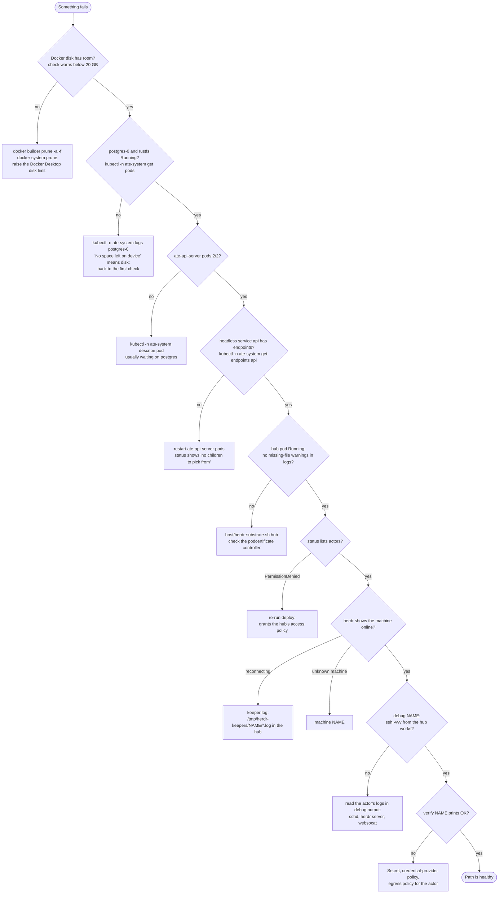

`host/herdr-substrate.sh debug <actor>` prints the actor's state and logs, the hub's logs, and `ssh -vvv` from
the hub.

| Symptom | Cause and fix |
|---|---|
| `postgres-0` or `rustfs` in CrashLoopBackOff; postgres log "No space left on device"; `ate-api-server` pods 1/2 | Docker's disk is full. See [Disk and resources](#disk-and-resources-quick-start) |
| `apt-get update`: "At least one invalid signature was encountered" | Docker's disk is full: `docker builder prune -a -f`, raise the disk limit |
| `check`: builder "uses the 'docker-container' driver" / push: `dial tcp … :5001: i/o timeout` | set `BUILDX_BUILDER=desktop-linux` (Linux: `default`) in `.env` |
| `missing on PATH: kubectl-ate` | `export PATH="$(go env GOPATH)/bin:$PATH"` (the script also finds it there on its own) |
| `status`: `rpc error: code = Unavailable desc = no children to pick from` | ate-api has no ready pods; usually postgres is down. `kubectl -n ate-system get pods` |
| `status`: `PermissionDenied … lacks "can_list_actors"` | the hub's access policy is missing; re-run `deploy` |
| `deploy`: "no hub SSH key" | run `hub` (the key is kept on the hub's volume; `.state` is only a local copy) |
| `herdr: cannot attach without a usable terminal: … zero-sized grid` | use `host/herdr-substrate.sh attach`, which sets the terminal size |
| `error: unknown machine '<name>'` | the `machine <name>` step hasn't completed; run it |
| `machine '<name>' is disabled` | disabled by hand, or by an older version of this kit. `herdr machine enable <id>` in the hub; `idle-watch` re-enables `ate-*` machines when the hub starts |
| Claude Code: "Unable to connect to Anthropic services … platform.claude.com: ENOTFOUND" | actor built from an older image without pre-completed onboarding. In its pane: `python3 -c 'import json,os;p=os.path.expanduser("~/.claude.json");d=json.load(open(p)) if os.path.exists(p) else {};d["hasCompletedOnboarding"]=True;json.dump(d,open(p,"w"))'` |
| `verify`: "API answered with an error" | the gateway didn't inject the key: check the Secret, and that `deploy` granted the credential-provider policy |
| `remote server is not ready for saved machines` | actor image without `setsid` (old build) or herdr version mismatch between hub and actor |
| `REMOTE HOST IDENTIFICATION HAS CHANGED` | template recreated outside `deploy`; in the hub: `ssh-keygen -R herdr-substrate-herdr-agents -f ~/.ssh/known_hosts.herdr-substrate` |
| An actor resumes right after being suspended | something connected through the router: input in a client (expected), or `verify`, `debug`, herdr's probes when a client starts. It is suspended again after `IDLE_SECONDS`; `logs` shows why it woke |
| `logs`: `not suspending, keeper reported: busy` | someone typed while the keepers were parking; the next poll tries again |
| `logs`: `not suspending, keeper reported: unsupported` | the actor's image has no `herdr-anchor` (built before it existed): it works, but can't be suspended under an attached client. Rebuild with `image`, then `down` and `deploy` to recreate the template |
| A machine shows `reconnecting` after a long suspend | the resume took longer than `HERDR_KEEPER_WAKE_TIMEOUT` (180 s), or the actor lost its session (reverted, crashed, or the anchor's 15-minute cleanup ran). herdr reconnects by itself; the keeper log in the hub (`/tmp/herdr-keepers/<name>/`) says which |
| `web`: "this hub image has no web terminal" | the hub runs an image from before ttyd was added: `hub-image` (or a newer `HUB_IMAGE`), then `hub` |
| `web`: "port-forward failed" | something else uses local port 7681: `WEB_PORT=7682 host/herdr-substrate.sh web` |
| Web: selecting text doesn't copy, or says "The browser blocked the copy" | the page isn't on `localhost` or `https` (browsers only allow clipboard access there), or Safari refused. Use `web`'s `http://localhost` URL or the shared `https` link; Chrome and Edge allow it |
| Web: the browser's menu still covers herdr's on right-click | the hub started without its page (`logs` shows "could not build the web page"), or runs an older image: `hub-image`, then `hub` |
| The web page says "Press ⏎ to Reconnect" | the WebSocket dropped (laptop asleep, `web` stopped, proxy timeout). Restart `web` if needed and press Enter: a fresh herdr client starts, nothing on the hub or the actors is lost |
| zsh: a pasted command waits at `quote>` | it contained a `#` comment with an apostrophe; press Ctrl-C. `setopt interactive_comments` in `~/.zshrc` makes zsh accept comments |

## Changelog

Fixes made while bringing the kit up on a real cluster, all included above:

- **Hub topology.** The herdr client and lifecycle controller moved from the laptop into a hub pod: the router
  admits only allowlisted SPIFFE identities, and actors can't host the client. `cluster` allowlists the hub.
- **Actor image:** no duplicate sftp `Subsystem` (fatal on Debian's OpenSSH); herdr server started with `setsid`;
  Claude Code onboarding pre-completed.
- **Hub image:** root's home set via `/etc/passwd` (not `usermod`); `ssh` called with `-F`.
- **Host script:** builder-driver check; digest fallback to the registry; `demo counter` subcommand; counter
  workers scaled to 0; `kubectl-ate` found in Go's bin directory; hub key fetched from the hub when `.state` lacks
  it; credential-provider policy read correctly; access/egress policy existence decided by output; `attach` sets
  the terminal size; disk-space warnings; new `verify` and `delete` commands.
- **Tests:** keep your Docker context when switching `HOME`; print the container log when sshd fails.
- **Production:** guides for GKE and upstream Kubernetes (`docs/`). The script gained `PLATFORM`,
  `CLAUDE_CODE_VERSION`, `WORKER_IMAGE`, `WORKER_NODE_SELECTOR`, `CREDENTIAL_PROVIDER` and `CREDENTIAL_URI`, and
  reads digests from remote registries. Defaults leave kind unchanged. The actor template no longer sets
  `snapshotConfig.storageLocation`, which substrate ignores without its `PerTemplateSnapshotLocation` preview gate.
- **Prebuilt images:** a GitHub workflow publishes `herdr-actor` and `herdr-hub` to GHCR for amd64 and arm64.
  The script takes them through `ACTOR_IMAGE` and `HUB_IMAGE`, by tag or digest. The hub image now takes
  `kubectl-ate` from `hub/bin/linux-<arch>/`, so one build can cover several platforms.
- **Always-on machines:** herdr machines are no longer disabled while their actor is suspended.
  - **How:** a `herdr-keeper` in the hub answers herdr's health checks for a parked machine, and a `herdr-anchor`
    in the actor keeps the session alive across the suspend. Input wakes the actor.
  - **Idle detection:** idle means no working or blocked agent *and* no input, and only running actors are polled.
  - **Older images:** actors without the anchor fall back to a plain relay and aren't suspended under an
    attached client.
- **herdr in the browser:** copying a selection, pasting with `ctrl+v`, and herdr's right-click menu work in the
  browser (`hub/herdr-web.js`). Before, ttyd ignored herdr's copies and the browser's menu covered herdr's.
- **herdr in the browser:** the hub runs ttyd on its loopback, and the new `web` command port-forwards to it and
  opens the page. Each guide's step 14 adds a shared link behind sign-in: IAP on GKE, oauth2-proxy elsewhere.
- **Container `/tmp`:** the actor entrypoint sets `/tmp` and `/var/tmp` to mode 1777, which Claude Code needs
  for its cross-session messaging socket.
