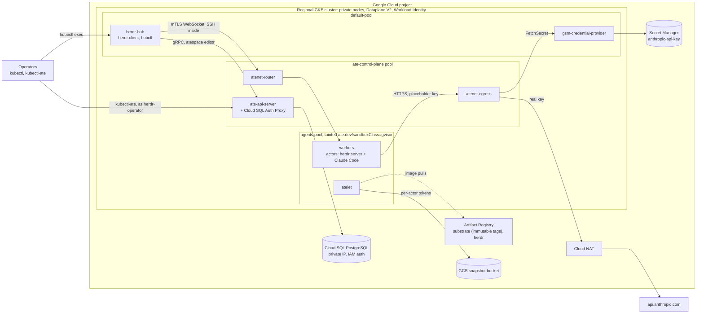

# herdr × agent-substrate in production on GKE

This guide runs the kit on Google Kubernetes Engine (GKE), hardened for production. The design is unchanged from the [quick start](../README.md#quick-start-on-kind):

- Every agent is a substrate actor in a gVisor sandbox, running a herdr server and Claude Code.
- A hub pod holds the herdr client and suspends idle actors.
- The Anthropic API key never enters a sandbox.

What changes is everything around it:

- Substrate is pinned to a release.
- Images come from your own registry, pinned by digest.
- State lives in managed services.
- Each identity gets only the rights it needs.

GKE is the cluster substrate's installer targets outside kind. For any other Kubernetes, see
[production-kubernetes.md](production-kubernetes.md).

## Contents

- [What changes from the quick start](#what-changes-from-the-quick-start)
- [Architecture](#architecture)
- [Before you start](#before-you-start)
- [1. Workstation and settings](#1-workstation-and-settings)
- [2. Project, network and registries](#2-project-network-and-registries)
- [3. Cluster](#3-cluster)
- [4. Snapshot storage and IAM](#4-snapshot-storage-and-iam)
- [5. Cloud SQL](#5-cloud-sql)
- [6. Substrate images](#6-substrate-images)
- [7. Install substrate](#7-install-substrate)
- [8. Identities and the atespace](#8-identities-and-the-atespace)
- [9. The Anthropic key in Secret Manager](#9-the-anthropic-key-in-secret-manager)
- [10. The kit](#10-the-kit)
- [11. Harden the hub](#11-harden-the-hub)
- [12. Agents](#12-agents)
- [13. Operators](#13-operators)
- [Operations](#operations)
- [Troubleshooting](#troubleshooting)
- [Production checklist](#production-checklist)

## What changes from the quick start

| | Quick start (README, kind) | GKE production |
|---|---|---|
| Substrate | a `main` checkout, built from source on every install | release **v0.6.0**, published once to your Artifact Registry, installed from a reviewed install document |
| Cluster | one node on Docker | regional, private nodes, Dataplane V2 (enforces NetworkPolicy), Workload Identity, three node pools |
| Agents' nodes | shared with everything | a dedicated pool, labeled and tainted `ate.dev/sandboxClass=gvisor` |
| Control plane | shared node | its own pool (`--cordon-control-plane`) |
| Database | in-cluster PostgreSQL | Cloud SQL, private IP, IAM authentication (no password anywhere), regional HA, backups |
| Snapshots | in-cluster S3 (rustfs) | GCS; every transfer runs on a token scoped to one actor |
| Anthropic key | Kubernetes Secret | Secret Manager, read by substrate's Secret Manager credential provider |
| Who runs `kubectl ate` | `ate-client`, a global owner | `herdr-operator`, owner of one atespace; `substrate-admin` is the only global owner |
| Images | `localhost:5001`, your machine's architecture | Artifact Registry, `linux/amd64`, digest-pinned, Claude Code version pinned |
| Hub | as described in the README | plus a default-deny NetworkPolicy, Pod Security `baseline`, operator RBAC, and its SSH key backed up |

Everything after the substrate install still goes through `host/herdr-substrate.sh`. Settings in the kit's
`.env` point it at GKE ([Configuration](../README.md#configuration)).

## Architecture



The three paths into the cluster ([README](../README.md#three-paths-into-the-cluster)) are the same.
One thing differs: your `kubectl ate` calls run as `herdr-operator`, not as the shared `ate-client`.

## Before you start

- **A Google Cloud project** where you can create GKE clusters, Cloud SQL instances, buckets, service
  accounts and IAM bindings (Owner, or an equivalent set of admin roles).
- **GKE 1.37 or later.** Substrate needs the PodCertificateRequest and ClusterTrustBundle APIs, which GKE 1.37
  serves by default. Setting up a 1.36 cluster needs extra beta-API flags, and nodes that already exist need
  replacing; substrate's `tools/setup-gcp/README.md` describes this. This guide assumes 1.37.
- **Decisions to make now:**
  - the region;
  - the CIDR that may reach the cluster's control plane (your office or VPN);
  - who the herdr operators are.
- **Pre-1.0 caveat.** Substrate does not support upgrading between minor releases before 1.0. A new substrate
  release means a new cluster ([Upgrades](#upgrades)).

Every command block below is ready to paste into bash or zsh. Each one assumes that
`source ~/herdr-prod/gke.env` has run in the current shell. Step 1 creates that file.

## 1. Workstation and settings

Tools:

- `gcloud` 576 or later. Older versions lack `--managed-otel-scope`.
- `kubectl`.
- `git`, `python3`.
- Docker with `buildx`.
- Go 1.27 or later. With the default `GOTOOLCHAIN=auto`, an older Go downloads the 1.27 toolchain that
  substrate's `go.mod` asks for.

```bash
gcloud version
kubectl version --client
go version
docker buildx version
python3 --version
```

Create the settings file:

```bash
mkdir -p ~/herdr-prod
cat > ~/herdr-prod/gke.env <<'EOF'
export PROJECT_ID=my-project
export REGION=europe-west6
export CLUSTER_NAME=herdr-prod
export RELEASE_CHANNEL=regular
export GKE_VERSION=1.37
export ADMIN_CIDR=203.0.113.0/24
export OPERATOR_EMAIL=alice@example.com
export AGENT_MACHINE_TYPE=n2-standard-8
export SUBSTRATE_VERSION=v0.6.0
export NETWORK=herdr-prod
export SUBNET=herdr-prod-nodes
export SQL_INSTANCE=herdr-substrate
export ANTHROPIC_SECRET=anthropic-api-key
export OPS_DIR=$HOME/herdr-prod
export SUBSTRATE_DIR=$OPS_DIR/substrate
export KIT_DIR=$OPS_DIR/herdr-substrate
export BUCKET_NAME=$PROJECT_ID-herdr-snapshots
export SNAPSHOT_TRANSFER_GSA_NAME=ate-snapshot-transfer
export REGISTRY_HOST=$REGION-docker.pkg.dev
export SUBSTRATE_REPO=$REGISTRY_HOST/$PROJECT_ID/substrate
export KIT_REPO=$REGISTRY_HOST/$PROJECT_ID/herdr
export NODE_SA=gke-herdr-nodes@$PROJECT_ID.iam.gserviceaccount.com
export KUBE_CONTEXT=gke_${PROJECT_ID}_${REGION}_${CLUSTER_NAME}
export GCE_REGION=$REGION
EOF
```

Edit the first eight lines to your values:

- `ADMIN_CIDR` is the network that may reach the Kubernetes API, such as your office or VPN egress range.
- `OPERATOR_EMAIL` is the Google account of the first herdr operator; [step 13](#13-operators) adds more.

Then load the file:

```bash
${EDITOR:-vi} ~/herdr-prod/gke.env
source ~/herdr-prod/gke.env
```

Fetch substrate at the pinned release, and unpack the kit next to it. Use the folder that holds
`herdr-substrate-kit.zip`:

```bash
git clone --branch "$SUBSTRATE_VERSION" --depth 1 https://github.com/agent-substrate/substrate "$SUBSTRATE_DIR"
git -C "$SUBSTRATE_DIR" describe --tags --exact-match
unzip -q ~/Downloads/herdr-substrate-kit.zip -d "$OPS_DIR"
ls "$KIT_DIR/host/herdr-substrate.sh"
```

Install `kubectl-ate` **from that checkout**. Its API package changed between v0.6.0 and later commits, so a
kubectl-ate built from another commit can't talk to this cluster:

```bash
cd "$SUBSTRATE_DIR"
go install ./cmd/kubectl-ate
export PATH="$(go env GOPATH)/bin:$PATH"
kubectl ate --help >/dev/null && echo kubectl-ate ok
```

## 2. Project, network and registries

APIs, credentials for the tools, and Docker access to Artifact Registry:

```bash
gcloud config set project "$PROJECT_ID"
gcloud services enable container.googleapis.com artifactregistry.googleapis.com storage.googleapis.com iam.googleapis.com iamcredentials.googleapis.com sts.googleapis.com sqladmin.googleapis.com servicenetworking.googleapis.com secretmanager.googleapis.com compute.googleapis.com logging.googleapis.com monitoring.googleapis.com cloudtrace.googleapis.com telemetry.googleapis.com cloudresourcemanager.googleapis.com serviceusage.googleapis.com networkconnectivity.googleapis.com
gcloud auth application-default login
gcloud auth configure-docker "$REGISTRY_HOST"
```

A dedicated VPC needs three things:

- **Private Google Access**, so private nodes reach Artifact Registry, GCS and Secret Manager.
- **Cloud NAT**, the only way out to `api.anthropic.com`.
- **Private services access**, which Cloud SQL's private IP needs.

```bash
gcloud compute networks create "$NETWORK" --subnet-mode=custom
gcloud compute networks subnets create "$SUBNET" --network="$NETWORK" --region="$REGION" --range=10.10.0.0/20 --secondary-range=pods=10.20.0.0/14,services=10.24.0.0/20 --enable-private-ip-google-access
gcloud compute routers create "$NETWORK-router" --network="$NETWORK" --region="$REGION"
gcloud compute routers nats create "$NETWORK-nat" --router="$NETWORK-router" --region="$REGION" --auto-allocate-nat-external-ips --nat-all-subnet-ip-ranges
gcloud compute addresses create "google-managed-services-$NETWORK" --global --purpose=VPC_PEERING --prefix-length=16 --network="$NETWORK"
gcloud services vpc-peerings connect --service=servicenetworking.googleapis.com --ranges="google-managed-services-$NETWORK" --network="$NETWORK"
```

Create a node service account with the least-privilege GKE node role, and two repositories:

- `substrate` holds release images, so its tags are immutable.
- `herdr` holds the kit's images, which are re-pushed as `:dev`.

```bash
gcloud iam service-accounts create gke-herdr-nodes --display-name="GKE nodes for herdr"
gcloud projects add-iam-policy-binding "$PROJECT_ID" --member="serviceAccount:$NODE_SA" --role=roles/container.defaultNodeServiceAccount --condition=None
gcloud artifacts repositories create substrate --repository-format=docker --location="$REGION" --immutable-tags
gcloud artifacts repositories create herdr --repository-format=docker --location="$REGION"
gcloud artifacts repositories add-iam-policy-binding substrate --location="$REGION" --member="serviceAccount:$NODE_SA" --role=roles/artifactregistry.reader
gcloud artifacts repositories add-iam-policy-binding herdr --location="$REGION" --member="serviceAccount:$NODE_SA" --role=roles/artifactregistry.reader
```

Pulls go through this node account in two ways:

- The kubelet pulls with it.
- atelet pulls actor images with it too, through the node's kubelet credential provider.

So read access on the two repositories is all the account needs.

## 3. Cluster

Check that your release channel offers 1.37 in this region. If it doesn't, set `RELEASE_CHANNEL` to one that
does:

```bash
gcloud container get-server-config --location="$REGION" --format="yaml(channels)"
```

The cluster comes up with only its default pool:

- **Private nodes**: no public IPs, outbound traffic through Cloud NAT.
- **Control-plane access** limited to `ADMIN_CIDR`.
- **Dataplane V2.** Substrate's own NetworkPolicies, and the hub's from step 11, are only enforced with it.
- **Workload Identity**, which ate-api-server, atelet and the Secret Manager provider use.
- **Managed OpenTelemetry**, which substrate's GKE manifests export to.
- **Shielded nodes.**

```bash
gcloud container clusters create "$CLUSTER_NAME" --location="$REGION" --release-channel="$RELEASE_CHANNEL" --cluster-version="$GKE_VERSION" --network="$NETWORK" --subnetwork="$SUBNET" --enable-ip-alias --cluster-secondary-range-name=pods --services-secondary-range-name=services --enable-private-nodes --enable-master-authorized-networks --master-authorized-networks="$ADMIN_CIDR" --enable-dataplane-v2 --workload-pool="$PROJECT_ID.svc.id.goog" --managed-otel-scope=COLLECTION_AND_INSTRUMENTATION_COMPONENTS --service-account="$NODE_SA" --shielded-secure-boot --shielded-integrity-monitoring --machine-type=e2-standard-4 --num-nodes=1
```

Two more pools:

- **`ate-control-plane`** carries the label and taint that `--cordon-control-plane` expects, so the control
  plane never shares a node with agents.
- **`agents`** carries `ate.dev/sandboxClass=gvisor`. atelet tolerates that taint, and ate-controller adds the
  matching toleration to worker pods. The kit's WorkerPool selects it in step 10.
  - It also gets the kernel sysctls substrate recommends for many sandboxes per node.
  - Don't enable GKE Sandbox on it. Substrate runs its own gVisor inside unprivileged worker pods.

```bash
cat > "$OPS_DIR/agents-systemconfig.yaml" <<'EOF'
linuxConfig:
  sysctls:
    net.ipv4.neigh.default.gc_thresh1: '4096'
    net.ipv4.neigh.default.gc_thresh2: '16384'
    net.ipv4.neigh.default.gc_thresh3: '32768'
    fs.inotify.max_user_instances: '65536'
    fs.inotify.max_user_watches: '1048576'
EOF
gcloud container node-pools create ate-control-plane --cluster="$CLUSTER_NAME" --location="$REGION" --machine-type=e2-standard-4 --num-nodes=1 --node-labels=ate.dev/workloadType=ate-control-plane --node-taints=ate.dev/workloadType=ate-control-plane:NoSchedule --service-account="$NODE_SA" --shielded-secure-boot --shielded-integrity-monitoring
gcloud container node-pools create agents --cluster="$CLUSTER_NAME" --location="$REGION" --machine-type="$AGENT_MACHINE_TYPE" --num-nodes=1 --enable-autoscaling --min-nodes=1 --max-nodes=4 --disk-type=pd-balanced --disk-size=200 --node-labels=ate.dev/sandboxClass=gvisor --node-taints=ate.dev/sandboxClass=gvisor:NoSchedule --system-config-from-file="$OPS_DIR/agents-systemconfig.yaml" --service-account="$NODE_SA" --shielded-secure-boot --shielded-integrity-monitoring
```

A regional cluster puts `--num-nodes` in **each** of the region's zones: three nodes per pool to start.

Connect, and check that both APIs substrate needs are served:

```bash
gcloud container clusters get-credentials "$CLUSTER_NAME" --location="$REGION"
kubectl --context "$KUBE_CONTEXT" api-resources --api-group=certificates.k8s.io
kubectl --context "$KUBE_CONTEXT" get nodes -L ate.dev/workloadType,ate.dev/sandboxClass
```

`clustertrustbundles` and `podcertificaterequests` must both be listed.

## 4. Snapshot storage and IAM

Substrate's `setup-gcp` tool creates two buckets:

- the snapshot bucket;
- an asset bucket for microVM sandboxes, which gVisor doesn't use.

It then grants Workload Identity access to `ate-system/ate-api-server` and `ate-system/atelet`, and creates the
snapshot transfer service account. `--gke-nodes=false` skips its broad node grant, since step 2 scoped
the node account to the two repositories.

```bash
cd "$SUBSTRATE_DIR"
go run ./tools/setup-gcp create bucket
go run ./tools/setup-gcp create iam --gke-nodes=false
gcloud storage buckets update "gs://$BUCKET_NAME" --public-access-prevention
```

On GCS, atelet gets no access to the snapshot bucket at all. Every snapshot upload or download runs on a token
that ate-api-server's credential exchange issues for that actor's prefix only.

## 5. Cloud SQL

A private-IP PostgreSQL instance with IAM database authentication. ate-api-server reaches it through the Cloud
SQL Auth Proxy as the `ate-api-server` Google service account, with no password. The tool also enables backups
and point-in-time recovery, and turns on deletion protection. Then make it regional (high availability):

```bash
cd "$SUBSTRATE_DIR"
go run ./tools/setup-gcp create cloudsql --instance="$SQL_INSTANCE" --network="$NETWORK"
gcloud sql instances patch "$SQL_INSTANCE" --availability-type=REGIONAL
```

Next, the one-time roles and schema substrate expects. Only the `postgres` user can create them, it has no
password yet, and only the cluster can reach the private IP. So:

1. Give `postgres` a temporary password.
2. Run the grants from a throwaway pod.
3. Scramble the password again.

```bash
PGPW="$(openssl rand -hex 16)"
gcloud sql users set-password postgres --instance="$SQL_INSTANCE" --password="$PGPW"
SQL_IP="$(gcloud sql instances describe "$SQL_INSTANCE" --format='value(ipAddresses[0].ipAddress)')"
kubectl --context "$KUBE_CONTEXT" run psql-grant --rm -i --restart=Never --image=postgres:18-alpine -- psql "postgresql://postgres:${PGPW}@${SQL_IP}:5432/atepg?sslmode=require" -v ON_ERROR_STOP=1 <<EOF
BEGIN;
CREATE ROLE substrate_owner NOLOGIN;
CREATE ROLE substrate_readwrite NOLOGIN;
GRANT substrate_owner TO postgres WITH SET TRUE;
GRANT substrate_owner, substrate_readwrite TO "ate-api-server@${PROJECT_ID}.iam";
CREATE SCHEMA substrate AUTHORIZATION substrate_owner;
GRANT USAGE ON SCHEMA substrate TO substrate_readwrite;
ALTER DEFAULT PRIVILEGES FOR ROLE substrate_owner IN SCHEMA substrate GRANT SELECT, INSERT, UPDATE, DELETE ON TABLES TO substrate_readwrite;
ALTER DEFAULT PRIVILEGES FOR ROLE substrate_owner IN SCHEMA substrate GRANT USAGE, SELECT, UPDATE ON SEQUENCES TO substrate_readwrite;
ALTER DEFAULT PRIVILEGES FOR ROLE substrate_owner IN SCHEMA substrate GRANT EXECUTE ON ROUTINES TO substrate_readwrite;
ALTER DEFAULT PRIVILEGES FOR ROLE substrate_owner IN SCHEMA substrate GRANT USAGE ON TYPES TO substrate_readwrite;
COMMIT;
EOF
gcloud sql users set-password postgres --instance="$SQL_INSTANCE" --password="$(openssl rand -hex 16)"
unset PGPW
```

The temporary password is visible to anyone who can read pods in `default` while that pod runs. That's one
reason to scramble it straight after. Details: substrate's `tools/setup-gcp/cloud-sql.md`.

## 6. Substrate images

Build every substrate image once, from the release checkout, and push it to your registry. The installer then
pins each one by digest. The images a release publishes on GitHub don't make up a complete install. This
command builds the full set, including `envoy-dataplane` and `ateworker-gvisor`:

```bash
cd "$SUBSTRATE_DIR"
VERSION="$SUBSTRATE_VERSION" KO_DEFAULTPLATFORMS=linux/amd64 go run ./cmd/ate-setup --no-dev-env publish release-images --ko-docker-repo "$SUBSTRATE_REPO"
gcloud artifacts docker images list "$SUBSTRATE_REPO" --include-tags --filter="tags:$SUBSTRATE_VERSION" --format="value(package)"
```

Because the `substrate` repository's tags are immutable, nothing can later swap the image behind
`v0.6.0`.

## 7. Install substrate

The install is described in a document you keep and review, not in shell flags. Secrets don't belong in it,
and with Cloud SQL IAM authentication there are none.

```bash
mkdir -p "$OPS_DIR/substrate-installs"
cat > "$OPS_DIR/substrate-install.yaml" <<EOF
apiVersion: install.ate.dev/v1alpha1
kind: SubstrateInstall
namespace: ate-system
context: ${KUBE_CONTEXT}
rolloutTimeout: 5m0s
images:
  repo: ${SUBSTRATE_REPO}
  tag: ${SUBSTRATE_VERSION}
gcp:
  projectID: ${PROJECT_ID}
  clusterLocation: ${REGION}
  clusterName: ${CLUSTER_NAME}
storage:
  bucketName: ${BUCKET_NAME}
  snapshotLocation: gs://${BUCKET_NAME}/
  transferGSAName: ${SNAPSHOT_TRANSFER_GSA_NAME}
ateapi:
  authz:
    bootstrapOwners: system:serviceaccount:ate-system:substrate-admin
  postgres:
    cloudsql:
      instance: ${PROJECT_ID}:${REGION}:${SQL_INSTANCE}
      gsa: ate-api-server@${PROJECT_ID}.iam.gserviceaccount.com
atenet:
  dataplane: envoy
  egress:
    credentialProvider: '{"name":"secretmanager.googleapis.com","address":"gsm-credential-provider.ate-system.svc:50051"}'
ingressAllowedSPIFFEIDs: spiffe://cluster.local/ns/herdr-hub/sa/herdr-hub
cordonControlPlane: true
record:
  dir: ${OPS_DIR}/substrate-installs
EOF
cat "$OPS_DIR/substrate-install.yaml"
```

What each line decides:

- **`bootstrapOwners`** names the only global owner: `substrate-admin`, a ServiceAccount nobody holds a token
  for until step 8. The default would make the shared `ate-client` a global owner, so that anyone who can mint
  its token owns every atespace.
- **`credentialProvider`** points the egress gateway at the Secret Manager provider, which step 9 deploys.
  Until then, requests that need the key fail closed with 503.
- **`ingressAllowedSPIFFEIDs`** is the router's mTLS allowlist: only the hub may open tunnels to actors.
- **`cordonControlPlane`** keeps the control plane on its own pool. Postgres is Cloud SQL, so no Postgres pool
  is needed.
- **`gcp.*`** lets the installer derive ate-api's token issuer, the GKE cluster's own.

Install:

```bash
cd "$SUBSTRATE_DIR"
go run ./cmd/ate-setup --no-dev-env --config "$OPS_DIR/substrate-install.yaml" deploy ate-system
```

The run prints every resolved setting and where it came from. It writes the record to
`$OPS_DIR/substrate-installs/` as well; commit that file along with `substrate-install.yaml`. Expect these:

```bash
kubectl --context "$KUBE_CONTEXT" -n ate-system get pods -o wide
kubectl --context "$KUBE_CONTEXT" -n ate-system logs deployment/ate-api-server -c cloud-sql-proxy --tail=5
```

- every `ate-system` pod `Running`, on `ate-control-plane` nodes;
- atelet on `agents` nodes;
- the proxy log ending in "ready for new connections".

## 8. Identities and the atespace

Two ServiceAccounts become ate-api principals:

- **`substrate-admin`** is the bootstrap owner, for platform admins only.
- **`herdr-operator`** owns the `herdr-agents` atespace and nothing else. The kit acts as it.

```bash
kubectl --context "$KUBE_CONTEXT" -n ate-system create serviceaccount substrate-admin
kubectl --context "$KUBE_CONTEXT" -n ate-system create serviceaccount herdr-operator
```

As `substrate-admin`, create the atespace and its access policy: `herdr-operator` as owner, the hub as editor.
`ATE_CLIENT_SERVICE_ACCOUNT` makes `kubectl ate` mint its token for that ServiceAccount. Your own Kubernetes
credentials must allow `create serviceaccounts/token` on it; a cluster admin's do.

```bash
cat > "$OPS_DIR/herdr-agents-access.yaml" <<'EOF'
metadata:
  name: default
bindings:
- role: owner
  members:
  - user:system:serviceaccount:ate-system:herdr-operator
- role: editor
  members:
  - user:system:serviceaccount:herdr-hub:herdr-hub
EOF
ATE_CLIENT_SERVICE_ACCOUNT=substrate-admin kubectl ate --context "$KUBE_CONTEXT" create atespace herdr-agents
ATE_CLIENT_SERVICE_ACCOUNT=substrate-admin kubectl ate --context "$KUBE_CONTEXT" create access-policy -a herdr-agents -f "$OPS_DIR/herdr-agents-access.yaml"
ATE_CLIENT_SERVICE_ACCOUNT=herdr-operator kubectl ate --context "$KUBE_CONTEXT" get access-policy -a herdr-agents
```

The last command runs as `herdr-operator` and must print the policy.

## 9. The Anthropic key in Secret Manager

Store the key in Secret Manager. Nothing in the cluster stores it; only the provider reads it, per request.

```bash
printf 'Anthropic API key: '; read -rs key; printf '\n'
printf '%s' "$key" | gcloud secrets create "$ANTHROPIC_SECRET" --replication-policy=user-managed --locations="$REGION" --data-file=-
unset key
```

Let the provider's Kubernetes ServiceAccount read **this one secret**, through its Workload Identity principal:

```bash
PROJECT_NUMBER="$(gcloud projects describe "$PROJECT_ID" --format='value(projectNumber)')"
gcloud secrets add-iam-policy-binding "$ANTHROPIC_SECRET" --role=roles/secretmanager.secretAccessor --member="principal://iam.googleapis.com/projects/$PROJECT_NUMBER/locations/global/workloadIdentityPools/$PROJECT_ID.svc.id.goog/subject/ns/ate-system/sa/gsm-credential-provider"
```

Next comes the provider's own policy, which is default-deny: actors in `herdr-agents` may resolve secrets in
this project. Then build the provider pinned by digest, review the manifest, and apply it. Its image goes to
the mutable `herdr` repository, because ko tags every build `latest`.

```bash
cat <<EOF | kubectl --context "$KUBE_CONTEXT" apply -f -
apiVersion: v1
kind: ConfigMap
metadata:
  name: gsm-credential-provider-project-policy
  namespace: ate-system
data:
  project-policy.yaml: |
    policies:
    - atespace: herdr-agents
      allowedProjects:
      - ${PROJECT_ID}
EOF
cd "$SUBSTRATE_DIR/internal/plugins/gcp-secret-manager"
KO_DOCKER_REPO="$KIT_REPO" KO_DEFAULTPLATFORMS=linux/amd64 make release-manifest > "$OPS_DIR/gsm-credential-provider.yaml"
grep 'image:' "$OPS_DIR/gsm-credential-provider.yaml"
kubectl --context "$KUBE_CONTEXT" apply -f "$OPS_DIR/gsm-credential-provider.yaml"
kubectl --context "$KUBE_CONTEXT" -n ate-system rollout status deployment/gsm-credential-provider --timeout=5m
```

The provider accepts calls only from the egress gateway's SPIFFE ID, and only for projects its policy lists.
Within those, it can read only what its IAM grants allow: here, one secret.

## 10. The kit

Pin the Claude Code version that goes into the actor image. Look up the current release:

```bash
docker run --rm node:22-bookworm-slim npm view @anthropic-ai/claude-code version
```

Write the kit's `.env`. The worker image is the `ateworker-gvisor` from step 6, pinned by digest:

```bash
CLAUDE_CODE_VERSION="$(docker run --rm node:22-bookworm-slim npm view @anthropic-ai/claude-code version)"
WORKER_DIGEST="$(docker buildx imagetools inspect "$SUBSTRATE_REPO/ateworker-gvisor:$SUBSTRATE_VERSION" --format '{{json .Manifest}}' | python3 -c 'import json,sys; print(json.load(sys.stdin)["digest"])')"
cat > "$KIT_DIR/.env" <<EOF
SUBSTRATE_DIR=${SUBSTRATE_DIR}
KUBE_CONTEXT=${KUBE_CONTEXT}
REGISTRY=${KIT_REPO}
PLATFORM=linux/amd64
CLAUDE_CODE_VERSION=${CLAUDE_CODE_VERSION}
WORKER_IMAGE=${SUBSTRATE_REPO}/ateworker-gvisor@${WORKER_DIGEST}
WORKER_NODE_SELECTOR='{"ate.dev/sandboxClass": "gvisor"}'
WORKER_REPLICAS=3
IDLE_SECONDS=900
CREDENTIAL_PROVIDER=secretmanager.googleapis.com
CREDENTIAL_URI=ate-secret://secretmanager.googleapis.com/projects/${PROJECT_ID}/secrets/${ANTHROPIC_SECRET}/versions/latest
ATE_CLIENT_SERVICE_ACCOUNT=herdr-operator
EOF
cat "$KIT_DIR/.env"
```

| Setting | Why |
|---|---|
| `REGISTRY`, `PLATFORM` | Kit images go to Artifact Registry, built for the nodes rather than your laptop. On Apple silicon the amd64 build runs under emulation, so it's slower |
| `CLAUDE_CODE_VERSION` | The actor image no longer floats on `latest` |
| `WORKER_IMAGE`, `WORKER_NODE_SELECTOR` | Workers come from the release and run on the `agents` pool |
| `CREDENTIAL_PROVIDER`, `CREDENTIAL_URI` | `deploy` creates no Secret; each actor's egress policy names the Secret Manager version. `versions/latest` follows rotations ([Rotate the Anthropic key](#rotate-the-anthropic-key)) |
| `ATE_CLIENT_SERVICE_ACCOUNT` | Every `kubectl ate` call the script makes acts as `herdr-operator` |
| `WORKER_REPLICAS`, `IDLE_SECONDS` | Capacity, and how long an idle agent stays warm. See [Capacity](#capacity) |

Build both kit images and start the hub:

```bash
cd "$KIT_DIR"
host/herdr-substrate.sh check
host/herdr-substrate.sh image
host/herdr-substrate.sh hub-image
host/herdr-substrate.sh hub
```

**Or use the images from the kit's GitHub workflow** ([Prebuilt images](../README.md#prebuilt-images-from-github))
instead of building them here. Verify their provenance and copy them into your own registry, so the cluster
never pulls from GitHub. Then point `.env` at the copies and start the hub without building anything:

```bash
GHCR_OWNER=your-github-owner
KIT_VERSION=1.2.3
gh attestation verify "oci://ghcr.io/$GHCR_OWNER/herdr-actor:$KIT_VERSION" --owner "$GHCR_OWNER"
gh attestation verify "oci://ghcr.io/$GHCR_OWNER/herdr-hub:$KIT_VERSION-substrate-$SUBSTRATE_VERSION" --owner "$GHCR_OWNER"
docker buildx imagetools create --tag "$KIT_REPO/herdr-actor:$KIT_VERSION" "ghcr.io/$GHCR_OWNER/herdr-actor:$KIT_VERSION"
docker buildx imagetools create --tag "$KIT_REPO/herdr-hub:$KIT_VERSION-substrate-$SUBSTRATE_VERSION" "ghcr.io/$GHCR_OWNER/herdr-hub:$KIT_VERSION-substrate-$SUBSTRATE_VERSION"
printf 'ACTOR_IMAGE=%s\nHUB_IMAGE=%s\n' "$KIT_REPO/herdr-actor:$KIT_VERSION" "$KIT_REPO/herdr-hub:$KIT_VERSION-substrate-$SUBSTRATE_VERSION" >> "$KIT_DIR/.env"
cd "$KIT_DIR"
host/herdr-substrate.sh check
host/herdr-substrate.sh hub
```

The copies cover both platforms. Use a `herdr-hub` built for `$SUBSTRATE_VERSION`, the workflow's default.
With prebuilt images, the repository variable `CLAUDE_CODE_VERSION` pins Claude Code, not `.env`.

`hub-image` builds `kubectl-ate` from `$SUBSTRATE_DIR`, so the hub's client matches the cluster.

## 11. Harden the hub

The hub holds the SSH key to every agent and atespace-editor rights. Treat it like a bastion.

**Network.** Default-deny, then allow only:

- DNS;
- the router's mTLS port;
- ate-api;
- the Kubernetes API, which `kubectl-ate` reads trust bundles from.

`kubectl exec` doesn't use the pod network, so `attach` keeps working. The control plane's address comes from
the cluster's own endpoints:

```bash
kubectl --context "$KUBE_CONTEXT" get endpointslices -n default -l kubernetes.io/service-name=kubernetes -o json | python3 -c '
import json, sys
slices = json.load(sys.stdin)["items"]
ips = sorted({a for s in slices for e in s["endpoints"] for a in e["addresses"]})
port = slices[0]["ports"][0]["port"]
def peer(ns, app):
    return {"namespaceSelector": {"matchLabels": {"kubernetes.io/metadata.name": ns}},
            "podSelector": {"matchLabels": app}}
print(json.dumps({
  "apiVersion": "networking.k8s.io/v1", "kind": "NetworkPolicy",
  "metadata": {"name": "herdr-hub", "namespace": "herdr-hub"},
  "spec": {
    "podSelector": {},
    "policyTypes": ["Ingress", "Egress"],
    "ingress": [],
    "egress": [
      {"to": [peer("kube-system", {"k8s-app": "kube-dns"})],
       "ports": [{"protocol": "UDP", "port": 53}, {"protocol": "TCP", "port": 53}]},
      {"to": [peer("ate-system", {"app": "atenet-router"})], "ports": [{"protocol": "TCP", "port": 8443}]},
      {"to": [peer("ate-system", {"app": "ate-api-server"})], "ports": [{"protocol": "TCP", "port": 443}]},
      {"to": [{"ipBlock": {"cidr": ip + "/32"}} for ip in ips], "ports": [{"protocol": "TCP", "port": port}]},
    ],
  },
}))' | kubectl --context "$KUBE_CONTEXT" apply -f -
kubectl --context "$KUBE_CONTEXT" label namespace herdr-hub pod-security.kubernetes.io/enforce=baseline --overwrite
kubectl --context "$KUBE_CONTEXT" -n herdr-hub rollout restart deployment/herdr-hub
kubectl --context "$KUBE_CONTEXT" -n herdr-hub rollout status deployment/herdr-hub
```

This assumes cluster DNS is kube-dns, the GKE default. With NodeLocal DNSCache enabled, also allow UDP and TCP
53 to `169.254.20.10/32`.

**The SSH key.** It exists only on the hub's 1 GiB volume. If the volume is lost, the hub generates a new key
that no existing actor trusts. Back the key up to Secret Manager now:

```bash
kubectl --context "$KUBE_CONTEXT" -n herdr-hub exec deploy/herdr-hub -- cat /var/lib/herdr-hub/.ssh/id_ed25519 | gcloud secrets create herdr-hub-ssh-key --replication-policy=user-managed --locations="$REGION" --data-file=-
```

Restoring it is under [Disaster recovery](#disaster-recovery).

## 12. Agents

From here on it's the same commands as in the quick start, acting as `herdr-operator`:

```bash
cd "$KIT_DIR"
host/herdr-substrate.sh deploy
host/herdr-substrate.sh actor luna
host/herdr-substrate.sh machine luna
host/herdr-substrate.sh verify luna
host/herdr-substrate.sh attach
```

`deploy` does three things:

- creates the WorkerPool on the `agents` pool;
- finds the atespace and the hub's access binding from step 8 already in place;
- creates the ActorTemplate and waits for its golden snapshot.

`verify` must print `OK: luna reached the Anthropic API with the injected key`. The key took this route:

1. Secret Manager.
2. The provider.
3. The egress gateway.
4. Cloud NAT.
5. Anthropic.

Check where things landed:

```bash
kubectl --context "$KUBE_CONTEXT" -n herdr-agents get pods -o wide
host/herdr-substrate.sh status
```

## 13. Operators

An operator needs to:

- exec into the hub (`attach`, `machine`, `suspend`, `resume`, `status`, `verify`, `debug`, `logs`);
- reach ate-api as `herdr-operator` (`actor`, `delete`).

Grant exactly that. Repeat the `subjects` entry for each operator, or bind a Google group if your cluster uses
Google Groups for RBAC.

```bash
cat <<EOF | kubectl --context "$KUBE_CONTEXT" apply -f -
apiVersion: rbac.authorization.k8s.io/v1
kind: Role
metadata:
  name: herdr-operator
  namespace: ate-system
rules:
- apiGroups: [""]
  resources: ["serviceaccounts/token"]
  resourceNames: ["herdr-operator"]
  verbs: ["create"]
- apiGroups: [""]
  resources: ["services"]
  verbs: ["get"]
- apiGroups: [""]
  resources: ["pods"]
  verbs: ["list"]
- apiGroups: [""]
  resources: ["pods/portforward"]
  verbs: ["create"]
---
apiVersion: rbac.authorization.k8s.io/v1
kind: RoleBinding
metadata:
  name: herdr-operator
  namespace: ate-system
roleRef:
  apiGroup: rbac.authorization.k8s.io
  kind: Role
  name: herdr-operator
subjects:
- apiGroup: rbac.authorization.k8s.io
  kind: User
  name: ${OPERATOR_EMAIL}
---
apiVersion: rbac.authorization.k8s.io/v1
kind: Role
metadata:
  name: herdr-operator
  namespace: herdr-hub
rules:
- apiGroups: [""]
  resources: ["pods"]
  verbs: ["get", "list"]
- apiGroups: [""]
  resources: ["pods/exec"]
  verbs: ["create"]
- apiGroups: [""]
  resources: ["pods/log"]
  verbs: ["get"]
- apiGroups: ["apps"]
  resources: ["deployments"]
  verbs: ["get"]
---
apiVersion: rbac.authorization.k8s.io/v1
kind: RoleBinding
metadata:
  name: herdr-operator
  namespace: herdr-hub
roleRef:
  apiGroup: rbac.authorization.k8s.io
  kind: Role
  name: herdr-operator
subjects:
- apiGroup: rbac.authorization.k8s.io
  kind: User
  name: ${OPERATOR_EMAIL}
---
apiVersion: rbac.authorization.k8s.io/v1
kind: ClusterRole
metadata:
  name: herdr-operator-trust-bundles
rules:
- apiGroups: ["certificates.k8s.io"]
  resources: ["clustertrustbundles"]
  verbs: ["get", "list"]
---
apiVersion: rbac.authorization.k8s.io/v1
kind: ClusterRoleBinding
metadata:
  name: herdr-operator-trust-bundles
roleRef:
  apiGroup: rbac.authorization.k8s.io
  kind: ClusterRole
  name: herdr-operator-trust-bundles
subjects:
- apiGroup: rbac.authorization.k8s.io
  kind: User
  name: ${OPERATOR_EMAIL}
EOF
```

Each operator also needs `roles/container.clusterViewer` in the project, to get cluster credentials, and a copy
of the kit with the same `.env`. Check what an operator can do:

```bash
kubectl --context "$KUBE_CONTEXT" auth can-i create pods/exec -n herdr-hub --as "$OPERATOR_EMAIL"
kubectl --context "$KUBE_CONTEXT" auth can-i create serviceaccounts/herdr-operator --subresource=token -n ate-system --as "$OPERATOR_EMAIL"
kubectl --context "$KUBE_CONTEXT" auth can-i create serviceaccounts/substrate-admin --subresource=token -n ate-system --as "$OPERATOR_EMAIL"
```

The first two must print `yes`, the third `no`.

`hub`, `deploy` and `down` change cluster-scoped and namespace objects, so they stay with platform admins.

## Operations

### Capacity

The arithmetic:

- Each worker requests 3 GiB of memory and up to 2 CPUs, and holds one running actor at a time.
- An `n2-standard-8` (32 GiB) fits about eight workers after system overhead.
- `WORKER_REPLICAS` is how many agents can be **running** at once. Any number can exist suspended.
- The `agents` pool autoscales from one to four nodes per zone as workers are added.

To change capacity, set `WORKER_REPLICAS` in the kit's `.env` and re-run `host/herdr-substrate.sh deploy`. It
re-applies the WorkerPool and leaves the template alone.

`IDLE_SECONDS` trades warmth against capacity. A suspended agent resumes from its memory snapshot on the next
connection, so a short timeout costs a resume, not the session.

### Monitoring

Substrate exports traces and metrics to Managed OpenTelemetry. Its dashboards install with:

```bash
cd "$SUBSTRATE_DIR"
go run ./tools/setup-gcp create dashboards
```

Alerts worth setting:

- the hub pod restarting;
- `ate-api-server` not ready;
- Cloud SQL CPU or storage above 80%;
- WorkerPool `readyReplicas` below `replicas`;
- log matches for `egress denied` on `atenet-egress`;
- `PermissionDenied` in the hub's logs (`hubctl` lost its access).

The idle bridge's decisions are in `host/herdr-substrate.sh logs`.

### Rotate the Anthropic key

Add a version. Egress policies name `versions/latest`, so the provider serves it on the next request. Then
disable the old version:

```bash
printf 'New Anthropic API key: '; read -rs key; printf '\n'
printf '%s' "$key" | gcloud secrets versions add "$ANTHROPIC_SECRET" --data-file=-
unset key
gcloud secrets versions list "$ANTHROPIC_SECRET"
```

```bash
gcloud secrets versions disable OLD_VERSION_NUMBER --secret="$ANTHROPIC_SECRET"
```

### Rotate the hub's SSH key

The key is baked into the ActorTemplate, and templates are immutable. Rotating it therefore means a new
template, and new actors.

### Disaster recovery

| Lost | Recovery |
|---|---|
| Hub pod | Deployment recreates it; state is on its volume |
| Hub volume | Restore the key into the new hub (below), then `machine <name>` for each actor; existing actors keep working |
| A zone | Control plane, agents and Cloud SQL are regional; the hub's zonal disk waits for its zone (actors keep running, idle suspend pauses) |
| Database | Cloud SQL point-in-time recovery |
| An actor's work | Actors resume from their last snapshot; `kubectl ate revert actor <name> -a herdr-agents` goes back to it |
| The cluster | Recreate from this guide and the committed install document; actors and their snapshots don't move to a new cluster |

Restore the hub key into a fresh hub:

```bash
gcloud secrets versions access latest --secret=herdr-hub-ssh-key | kubectl --context "$KUBE_CONTEXT" -n herdr-hub exec -i deploy/herdr-hub -- sh -c 'umask 077; cat > "$HOME/.ssh/id_ed25519"; ssh-keygen -y -f "$HOME/.ssh/id_ed25519" > "$HOME/.ssh/id_ed25519.pub"'
kubectl --context "$KUBE_CONTEXT" -n herdr-hub exec deploy/herdr-hub -- hubctl pubkey
```

### Upgrades

| What | How |
|---|---|
| GKE | Release channel auto-upgrades. Workers get `SIGTERM` and 30 minutes to suspend their actors, so set a maintenance window |
| herdr or Claude Code | Rebuild with `image` (and `hub-image` for herdr). Templates are immutable, so new agents need a new template: run `down` and `deploy` in a maintenance window, then recreate the actors. `down` deletes the actors |
| Substrate, patch release | In place, by substrate's upgrade runbook (`docs/upgrade.md`), once releases are 1.0 or later |
| Substrate, new minor before 1.0 | Not supported in place. Stand up a second cluster from this guide at the new version, move operators over, delete the old one |

### Tear down

Run these in order:

1. Delete the herdr side, as `herdr-operator` and a cluster admin.
2. Remove substrate.
3. Delete the cloud resources.

Deleting the Cloud SQL instance needs its deletion protection cleared first.

```bash
cd "$KIT_DIR"
host/herdr-substrate.sh down
cd "$SUBSTRATE_DIR"
go run ./cmd/ate-setup --no-dev-env --config "$OPS_DIR/substrate-install.yaml" delete ate-system
gcloud container clusters delete "$CLUSTER_NAME" --location="$REGION"
gcloud sql instances patch "$SQL_INSTANCE" --no-deletion-protection
gcloud sql instances delete "$SQL_INSTANCE"
gcloud storage rm -r "gs://$BUCKET_NAME" "gs://$BUCKET_NAME-assets"
gcloud secrets delete "$ANTHROPIC_SECRET"
gcloud secrets delete herdr-hub-ssh-key
```

## Troubleshooting

Start with the [kit's troubleshooting chain](../README.md#troubleshooting). GKE-specific causes:

| Symptom | Cause and fix |
|---|---|
| Install hangs at "Waiting for podcertificate ClusterTrustBundles" | Cluster below 1.37 or beta APIs off: `kubectl api-resources --api-group=certificates.k8s.io` |
| `cloud-sql-proxy`: `PERMISSION_DENIED` | GSA missing `roles/cloudsql.client`, or its Workload Identity binding; re-run step 5's `create cloudsql` |
| ate-api: `role "substrate_owner" does not exist` / `permission denied for schema substrate` | Step 5's grants did not run |
| First suspend or resume fails with GCS `403` | Step 4's `create iam` missing, or Workload Identity off on the cluster |
| `verify`: HTTP 503 | The Secret Manager provider isn't serving: `kubectl -n ate-system rollout status deployment/gsm-credential-provider` |
| `verify`: HTTP 403 | Provider refused: the project policy lacks `herdr-agents`, or the secret's IAM binding is missing. `kubectl -n ate-system logs deployment/gsm-credential-provider` and `kubectl -n ate-system logs deployment/atenet-egress -c ext-proc \| grep 'egress denied'` |
| `verify` times out | No Cloud NAT, so nothing leaves the private nodes |
| WorkerPool pods `Pending` | `WORKER_NODE_SELECTOR` doesn't match the `agents` pool's labels, or the pool is at its autoscaling maximum |
| Golden snapshot never finishes; atelet logs image pull `401`/`403` | The node service account lacks `artifactregistry.reader` on the `herdr` repository |
| `machine`/`verify` hang after step 11 | The hub's NetworkPolicy blocks DNS or the control plane: check the policy's `ipBlock` against `kubectl get endpointslices -n default -l kubernetes.io/service-name=kubernetes` |
| `kubectl ate`: `PermissionDenied … lacks …` | Acting as the wrong identity: `.env` must set `ATE_CLIENT_SERVICE_ACCOUNT=herdr-operator`; step 8's policy must exist |
| `kubectl ate`: `unknown service` / `Unimplemented` | kubectl-ate built from another substrate commit; rebuild it from `$SUBSTRATE_DIR` (and `hub-image`) |
| `kubectl` times out | Your IP is outside `ADMIN_CIDR` |

## Production checklist

- [ ] Substrate pinned to a release; images in your registry with immutable tags; installed from a committed
      install document
- [ ] GKE 1.37 or later, regional, private nodes, Dataplane V2, Workload Identity, control plane limited to known CIDRs
- [ ] Agents on their own tainted pool; control plane on its own pool
- [ ] Cloud SQL regional, with backups and point-in-time recovery; no database passwords in use
- [ ] Snapshot bucket with public access prevention; transfers scoped per actor
- [ ] Anthropic key only in Secret Manager; provider limited to one secret and one atespace
- [ ] Bootstrap owner is `substrate-admin`; day-to-day work as `herdr-operator`; `ate-client` holds nothing
- [ ] Hub: NetworkPolicy, Pod Security `baseline`, exec limited to operators, SSH key backed up
- [ ] Claude Code and herdr versions pinned in the actor image
- [ ] Dashboards and alerts in place; maintenance window set
