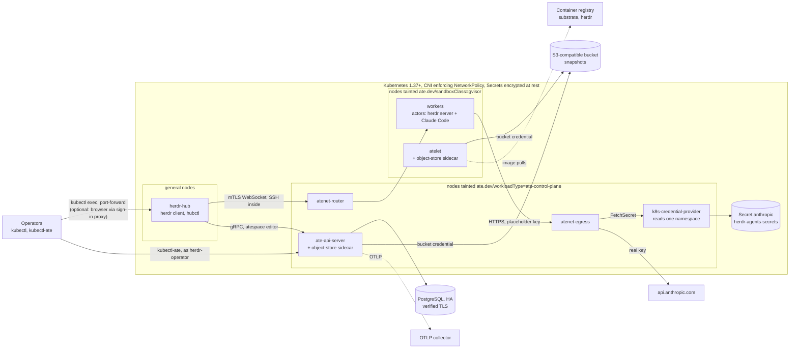
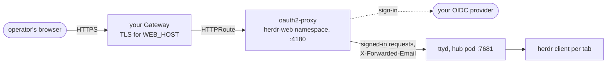

# herdr × agent-substrate in production on upstream Kubernetes

This guide runs the kit on a plain upstream Kubernetes cluster, hardened for production. Such a cluster might be
built with kubeadm, Cluster API, k0s, RKE2, Talos or similar, on your own hardware or a cloud's VMs. The design
is unchanged from the [quick start](../README.md#quick-start-on-kind):

- Every agent is a substrate actor in a gVisor sandbox, running a herdr server and Claude Code.
- A hub pod holds the herdr client and suspends idle actors.
- The Anthropic API key never enters a sandbox.

Substrate's installer knows two targets: kind, and GKE. On any other cluster you carry a small, reviewed patch
on top of the pinned substrate release:

- S3-compatible object storage instead of GCS;
- your own OpenTelemetry collector instead of GKE's;
- atelet image pulls that don't assume GKE's node layout.

Everything else matches [production-gke.md](production-gke.md). Read that guide's
[What changes from the quick start](production-gke.md#what-changes-from-the-quick-start) table for the overall shape.

## Contents

- [Differences from GKE](#differences-from-gke)
- [Architecture](#architecture)
- [Cluster requirements](#cluster-requirements)
- [1. Workstation and settings](#1-workstation-and-settings)
- [2. Check the cluster](#2-check-the-cluster)
- [3. Prepare the nodes](#3-prepare-the-nodes)
- [4. Object storage](#4-object-storage)
- [5. PostgreSQL](#5-postgresql)
- [6. Substrate images](#6-substrate-images)
- [7. The upstream overlay](#7-the-upstream-overlay)
- [8. Install substrate](#8-install-substrate)
- [9. Identities and the atespace](#9-identities-and-the-atespace)
- [10. The kit](#10-the-kit)
- [11. Harden the hub and the credential provider](#11-harden-the-hub-and-the-credential-provider)
- [12. Agents](#12-agents)
- [13. Operators](#13-operators)
- [14. Browser access](#14-browser-access)
- [Operations](#operations)
- [Troubleshooting](#troubleshooting)
- [Production checklist](#production-checklist)

## Differences from GKE

| | GKE guide | This guide |
|---|---|---|
| Install target | substrate's GKE manifests as shipped | the same manifests plus [a carried kustomize patch](#7-the-upstream-overlay) |
| Snapshots | GCS. Every transfer runs on a token scoped to one actor | **S3-compatible** store. Each node's object-store sidecar uses **one credential for the whole bucket** |
| Database | Cloud SQL, IAM auth, no passwords | PostgreSQL you run (HA), password logins over verified TLS |
| Anthropic key | Secret Manager provider | substrate's Kubernetes Secrets provider, scoped to one namespace, with Secrets encrypted at rest |
| Image pulls by atelet | GKE's node credential provider | anonymous from your registry, or your nodes' kubelet credential provider |
| Telemetry | Managed OpenTelemetry | your OTLP collector |
| Node pools | created with gcloud | nodes you label and taint |

The S3 row is the one to weigh. On GCS, a compromised node can read only the snapshots of actors that ran on it.
On S3, it can read every actor's snapshots, and so their memory. Keep the agents' nodes as trusted as the
control plane, or use GKE.

## Architecture



## Cluster requirements

| Requirement | Why |
|---|---|
| **Kubernetes 1.37 or later** | Substrate's identities are Pod Certificates (PodCertificateRequest) and ClusterTrustBundles, stable and on by default from 1.37. On 1.36, enable feature gates `ClusterTrustBundle`, `ClusterTrustBundleProjection` and `PodCertificateRequest` on the API server and kubelets, plus `--runtime-config=certificates.k8s.io/v1beta1=true` on the API server |
| **A CNI that enforces NetworkPolicy** (Calico, Cilium, …) | Substrate ships NetworkPolicies that are its isolation between components; step 11 adds the hub's. Flannel alone ignores them |
| **Linux nodes, cgroup v2, containerd** | Workers run unprivileged and need a private cgroup namespace; gVisor runs inside them. No `/dev/kvm` needed (that's for microVMs) |
| **Three kinds of nodes** | general (hub, cluster add-ons), control plane (substrate's services), agents (workers). One node can't be two kinds |
| **A default StorageClass** | The hub's 1 GiB volume |
| **Secrets encrypted at rest** (`--encryption-provider-config`, ideally KMS v2) | The Anthropic key, database DSNs and S3 credential are Kubernetes Secrets |
| **Outbound HTTPS to `api.anthropic.com`** from the control-plane nodes, and to `api.openai.com` and `generativelanguage.googleapis.com` for Codex and agy | The egress gateway runs there |
| **An S3-compatible object store** (AWS S3, MinIO, Ceph RGW, …) | Snapshots |
| **PostgreSQL 15 or later, highly available** | ate-api's store. The bundled single-pod database is for development |
| **A container registry your nodes can pull from** | Substrate's and the kit's images |
| **An OTLP (gRPC) collector** | Substrate's traces, metrics and events |

Every command block below is ready to paste into bash or zsh. Each one assumes that
`source ~/herdr-prod/k8s.env` has run in the current shell. Step 1 creates that file.

## 1. Workstation and settings

Tools:

- `kubectl` with a cluster-admin context;
- `git`, `python3`, `openssl`;
- `psql`, on a host that can reach the database;
- Docker with `buildx`, logged in to your registry;
- Go 1.27 or later. With `GOTOOLCHAIN=auto`, an older Go downloads 1.27.

```bash
kubectl version
go version
docker buildx version
psql --version
```

```bash
mkdir -p ~/herdr-prod
cat > ~/herdr-prod/k8s.env <<'EOF'
export KUBE_CONTEXT=prod
export REGISTRY_BASE=registry.example.com/platform
export PLATFORM=linux/amd64
export S3_ENDPOINT=https://s3.example.com
export S3_REGION=us-east-1
export S3_BUCKET=herdr-substrate-snapshots
export S3_PATH_STYLE=true
export OTEL_ENDPOINT=http://otel-collector.observability.svc:4317
export PG_HOST=postgres.example.com
export PG_PORT=5432
export PG_DATABASE=substrate
export OPERATOR_USER=alice@example.com
export AGENT_NODES="agent-1 agent-2 agent-3"
export CONTROL_PLANE_NODES="infra-1 infra-2 infra-3"
export SUBSTRATE_VERSION=v0.6.0
export OPS_DIR=$HOME/herdr-prod
export SUBSTRATE_DIR=$OPS_DIR/substrate
export KIT_DIR=$OPS_DIR/herdr-substrate
export SUBSTRATE_REPO=$REGISTRY_BASE/substrate
export KIT_REPO=$REGISTRY_BASE/herdr
export PG_CA_FILE=$OPS_DIR/postgres-ca.pem
EOF
```

Edit the first fifteen lines:

- `S3_PATH_STYLE` is `true` for MinIO and most self-hosted stores, and `false` for AWS S3, where `S3_ENDPOINT`
  is `https://s3.<region>.amazonaws.com`.
- `OPERATOR_USER` is the first herdr operator's Kubernetes username. Run `kubectl auth whoami` as them to see it.

Then put your database's CA certificate at `~/herdr-prod/postgres-ca.pem`, and load the settings:

```bash
${EDITOR:-vi} ~/herdr-prod/k8s.env
source ~/herdr-prod/k8s.env
ls -l "$PG_CA_FILE"
```

Fetch substrate at the pinned release, unpack the kit, and install `kubectl-ate` from the same checkout. A
kubectl-ate from another substrate commit can't talk to this cluster.

```bash
git clone --branch "$SUBSTRATE_VERSION" --depth 1 https://github.com/agent-substrate/substrate "$SUBSTRATE_DIR"
unzip -q ~/Downloads/herdr-substrate-kit.zip -d "$OPS_DIR"
cd "$SUBSTRATE_DIR"
go install ./cmd/kubectl-ate
export PATH="$(go env GOPATH)/bin:$PATH"
kubectl ate --help >/dev/null && echo kubectl-ate ok
```

## 2. Check the cluster

Both API groups served, the version, and the nodes:

```bash
kubectl --context "$KUBE_CONTEXT" version
kubectl --context "$KUBE_CONTEXT" api-resources --api-group=certificates.k8s.io
kubectl --context "$KUBE_CONTEXT" get nodes -o wide
kubectl --context "$KUBE_CONTEXT" get storageclass
```

- `clustertrustbundles` and `podcertificaterequests` must both be listed.
- One StorageClass must be marked `(default)`.

cgroup v2 on an agent node prints `cgroup2fs`:

```bash
kubectl --context "$KUBE_CONTEXT" debug "node/${AGENT_NODES%% *}" -it --profile=general --image=busybox:1.36 -- stat -fc %T /host/sys/fs/cgroup
```

`kubectl debug` leaves its pod behind; delete it with the command it prints. Then note the token issuer the API
server uses. ate-api trusts ServiceAccount tokens from exactly this issuer:

```bash
kubectl --context "$KUBE_CONTEXT" get --raw /.well-known/openid-configuration | python3 -c 'import json,sys; print(json.load(sys.stdin)["issuer"])'
```

## 3. Prepare the nodes

Label and taint the two dedicated kinds of node:

- `--cordon-control-plane` expects `ate.dev/workloadType=ate-control-plane` on substrate's nodes.
- The agents' nodes get `ate.dev/sandboxClass=gvisor`. atelet tolerates that taint, ate-controller adds the
  matching toleration to worker pods, and the kit's WorkerPool selects the label.

If your provisioning tool sets node labels and taints, set them there instead, so new nodes get them too.

```bash
echo "$CONTROL_PLANE_NODES" | xargs -n1 | xargs -I NODE kubectl --context "$KUBE_CONTEXT" label node NODE ate.dev/workloadType=ate-control-plane --overwrite
echo "$CONTROL_PLANE_NODES" | xargs -n1 | xargs -I NODE kubectl --context "$KUBE_CONTEXT" taint node NODE ate.dev/workloadType=ate-control-plane:NoSchedule --overwrite
echo "$AGENT_NODES" | xargs -n1 | xargs -I NODE kubectl --context "$KUBE_CONTEXT" label node NODE ate.dev/sandboxClass=gvisor --overwrite
echo "$AGENT_NODES" | xargs -n1 | xargs -I NODE kubectl --context "$KUBE_CONTEXT" taint node NODE ate.dev/sandboxClass=gvisor:NoSchedule --overwrite
kubectl --context "$KUBE_CONTEXT" get nodes -L ate.dev/workloadType,ate.dev/sandboxClass
```

Every awake sandbox costs host neighbour-table entries and inotify watches, and default kernel limits run out
at a few hundred sandboxes per node. Set substrate's recommended sysctls on the agents' nodes. Put them in your
node configuration if you can. Otherwise, use the DaemonSet substrate documents for this, here limited to
agent nodes:

```bash
cat <<'EOF' | kubectl --context "$KUBE_CONTEXT" apply -f -
apiVersion: apps/v1
kind: DaemonSet
metadata:
  name: substrate-sysctl-tuner
  namespace: kube-system
spec:
  selector:
    matchLabels:
      app: substrate-sysctl-tuner
  template:
    metadata:
      labels:
        app: substrate-sysctl-tuner
    spec:
      hostNetwork: true
      nodeSelector:
        ate.dev/sandboxClass: gvisor
      tolerations:
      - key: ate.dev/sandboxClass
        operator: Exists
        effect: NoSchedule
      containers:
      - name: sysctl-tuner
        image: busybox:1.36
        securityContext:
          privileged: true
        command:
        - sh
        - -ce
        - |
          sysctl -w net.ipv4.neigh.default.gc_thresh1=4096
          sysctl -w net.ipv4.neigh.default.gc_thresh2=16384
          sysctl -w net.ipv4.neigh.default.gc_thresh3=32768
          sysctl -w fs.inotify.max_user_instances=65536
          sysctl -w fs.inotify.max_user_watches=1048576
          sleep infinity
EOF
```

## 4. Object storage

Create a bucket for snapshots. Then create a credential that can use **only that bucket**, with these actions:

- `s3:ListBucket`
- `s3:GetObject`
- `s3:PutObject`
- `s3:DeleteObject`
- `s3:AbortMultipartUpload`
- `s3:ListMultipartUploadParts`

The bucket stays private. Don't enable lifecycle rules that expire objects: substrate deletes the snapshots
nothing refers to any more.

Store the credential where substrate's object-store sidecars read it. The namespace is created ahead of the
install:

```bash
kubectl --context "$KUBE_CONTEXT" create namespace ate-system
printf 'S3 access key ID: '; read -r s3id
printf 'S3 secret access key: '; read -rs s3secret; printf '\n'
kubectl --context "$KUBE_CONTEXT" -n ate-system create secret generic substrate-s3 --from-literal=AWS_ACCESS_KEY_ID="$s3id" --from-literal=AWS_SECRET_ACCESS_KEY="$s3secret"
unset s3id s3secret
```

The sidecars use the standard AWS SDK credential chain. On AWS you can replace the static key with a web
identity: annotate or project a token, and set `AWS_ROLE_ARN` and `AWS_WEB_IDENTITY_TOKEN_FILE` in the overlay.
The static key is what works on every S3-compatible store.

## 5. PostgreSQL

Substrate needs one database with:

- a schema owned by a `NOLOGIN` owner role;
- a `NOLOGIN` read/write role;
- one login for each of the two.

ate-api runs `SET ROLE` itself. Run substrate's own setup script as your database administrator, from a host
that can reach the database. Use a key=value connection string, so the database name can be appended:

```bash
printf 'Admin connection (key=value, e.g. host=... user=postgres password=... sslmode=verify-full sslrootcert=...): '; read -rs PG_ADMIN; printf '\n'
OWNER_PW="$(openssl rand -hex 24)"
RW_PW="$(openssl rand -hex 24)"
psql "$PG_ADMIN dbname=postgres" -v ON_ERROR_STOP=1 -c "CREATE DATABASE $PG_DATABASE"
psql "$PG_ADMIN dbname=$PG_DATABASE" -v ON_ERROR_STOP=1 -v substrate_schema=substrate -v substrate_owner_role=substrate_owner -v substrate_owner_user=substrate_owner_user -v substrate_owner_password="$OWNER_PW" -v substrate_readwrite_role=substrate_readwrite -v substrate_readwrite_user=substrate_readwrite_user -v substrate_readwrite_password="$RW_PW" -f "$SUBSTRATE_DIR/pkg/postgressetup/setup.sql"
unset PG_ADMIN
```

Build the two connection strings that ate-api will use:

- **TLS** is verified against the CA in `$PG_CA_FILE`. The installer stores that CA as a Secret and mounts it
  at `/run/postgres-server-ca`.
- **The passwords** stay out of the install document.

**Save both lines in your secret store now.** Every later `deploy ate-system` needs them again, and refuses to
run without them rather than fall back to a bundled database.

```bash
echo "export ATE_API_POSTGRES_OWNER_CONNECTION_STRING='postgres://substrate_owner_user:${OWNER_PW}@${PG_HOST}:${PG_PORT}/${PG_DATABASE}?sslmode=verify-full&sslrootcert=/run/postgres-server-ca/server-ca.pem'"
echo "export ATE_API_POSTGRES_READ_WRITE_CONNECTION_STRING='postgres://substrate_readwrite_user:${RW_PW}@${PG_HOST}:${PG_PORT}/${PG_DATABASE}?sslmode=verify-full&sslrootcert=/run/postgres-server-ca/server-ca.pem'"
```

## 6. Substrate images

Log in to your registry, then build every substrate image once, from the release checkout, and push it. The
images GitHub releases publish don't make up a complete install. This command builds the full set, including
`envoy-dataplane`, `ateworker-gvisor` and the Kubernetes Secrets credential provider:

```bash
docker login "${REGISTRY_BASE%%/*}"
cd "$SUBSTRATE_DIR"
VERSION="$SUBSTRATE_VERSION" KO_DEFAULTPLATFORMS="$PLATFORM" go run ./cmd/ate-setup --no-dev-env publish release-images --ko-docker-repo "$SUBSTRATE_REPO"
```

Make the `v0.6.0` tags immutable in your registry if it supports that (Harbor, ECR, Artifact Registry and
others do).

**Your nodes must be able to pull these images, and the kit's**, without image pull secrets. Substrate's
manifests don't carry any, and atelet pulls actor images itself. Pick one:

- **Anonymous pulls from inside the cluster network.** For example, a Harbor project marked public but reachable
  only from your private network. This is the default overlay in step 7.
- **A kubelet image credential provider on every node** (`--image-credential-provider-config`). The kubelet uses
  it, and you point atelet at the same plugin ([variant B](#variant-b-kubelet-credential-provider)).

## 7. The upstream overlay

Substrate installs any cluster that isn't kind from `manifests/ate-install/base`. That overlay assumes GKE in
four places, and the patch below replaces each one:

| GKE assumption | Replacement |
|---|---|
| Object storage is GCS with Workload Identity | `ATE_STORAGE_BACKEND=s3` and the `AWS_*` settings on the object-store sidecars of ate-api-server and atelet, with the key from `substrate-s3` |
| Telemetry goes to GKE's managed collector | `OTEL_EXPORTER_OTLP_ENDPOINT` points at yours |
| `atenet-router-monitoring.yaml`, a Google Managed Prometheus `PodMonitoring` | Dropped: the CRD doesn't exist here, so the install would fail on it |
| atelet reads GKE's kubelet credential-provider paths | atelet's two credential-provider flags and their host mounts are removed, so it pulls anonymously ([variant B](#variant-b-kubelet-credential-provider) keeps them) |

Write it into the pinned checkout:

```bash
cat > "$SUBSTRATE_DIR/manifests/ate-install/base/kustomization.yaml" <<EOF
# Upstream Kubernetes overlay, carried on ${SUBSTRATE_VERSION} for herdr-substrate.
# See docs/production-kubernetes.md in the herdr-substrate kit.
apiVersion: kustomize.config.k8s.io/v1beta1
kind: Kustomization

resources:
  - ../ate-api-server.yaml
  - ../ate-idp-server.yaml
  - ../ate-controller.yaml
  - ../atelet.yaml
  - ../atenet-router.yaml
  - ../ate-otel-config.yaml
  - ../ate-system-networkpolicies.yaml

patches:
  - patch: |-
      apiVersion: v1
      kind: ConfigMap
      metadata:
        name: ate-otel-config
        namespace: ate-system
      data:
        OTEL_EXPORTER_OTLP_ENDPOINT: ${OTEL_ENDPOINT}
  - patch: |-
      apiVersion: apps/v1
      kind: Deployment
      metadata:
        name: ate-api-server
        namespace: ate-system
      spec:
        template:
          spec:
            initContainers:
            - name: objectstore-plugin
              env:
              - name: ATE_STORAGE_BACKEND
                value: s3
              - name: AWS_REGION
                value: ${S3_REGION}
              - name: AWS_ENDPOINT_URL
                value: ${S3_ENDPOINT}
              - name: AWS_S3_USE_PATH_STYLE
                value: "${S3_PATH_STYLE}"
              - name: AWS_ACCESS_KEY_ID
                valueFrom:
                  secretKeyRef:
                    name: substrate-s3
                    key: AWS_ACCESS_KEY_ID
              - name: AWS_SECRET_ACCESS_KEY
                valueFrom:
                  secretKeyRef:
                    name: substrate-s3
                    key: AWS_SECRET_ACCESS_KEY
  - patch: |-
      apiVersion: apps/v1
      kind: DaemonSet
      metadata:
        name: atelet
        namespace: ate-system
      spec:
        template:
          spec:
            initContainers:
            - name: objectstore-plugin
              env:
              - name: ATE_STORAGE_BACKEND
                value: s3
              - name: AWS_REGION
                value: ${S3_REGION}
              - name: AWS_ENDPOINT_URL
                value: ${S3_ENDPOINT}
              - name: AWS_S3_USE_PATH_STYLE
                value: "${S3_PATH_STYLE}"
              - name: AWS_ACCESS_KEY_ID
                valueFrom:
                  secretKeyRef:
                    name: substrate-s3
                    key: AWS_ACCESS_KEY_ID
              - name: AWS_SECRET_ACCESS_KEY
                valueFrom:
                  secretKeyRef:
                    name: substrate-s3
                    key: AWS_SECRET_ACCESS_KEY
            containers:
            - name: atelet
              args:
              - --grpc-server-cred-bundle=/run/podidentity.podcert.ate.dev/credential-bundle.pem
              - --client-ca-certs=/run/podidentity.podcert.ate.dev/trust-bundle.pem
              - --ateapi-ca-file=/run/servicedns.podcert.ate.dev/trust-bundle.pem
              - --drain-delay=0s
              - --drain-timeout=5m
              - --objectstore-plugin-socket=/run/objectstore-plugin/node.sock
              volumeMounts:
              - mountPath: /run/image-credential-provider/bin
                \$patch: delete
              - mountPath: /run/image-credential-provider/config.yaml
                \$patch: delete
            volumes:
            - name: image-credential-provider-bin
              \$patch: delete
            - name: image-credential-provider-config
              \$patch: delete
EOF
git -C "$SUBSTRATE_DIR" diff --stat
kubectl kustomize --load-restrictor=LoadRestrictionsNone "$SUBSTRATE_DIR/manifests/ate-install/base" | grep -E 'ATE_STORAGE_BACKEND|value: s3|OTEL_EXPORTER_OTLP_ENDPOINT|image-credential-provider|PodMonitoring' -A1
```

`--load-restrictor` is needed because the overlay, like substrate's own, reads manifests from the directory
above it; ate-setup builds it the same way. The check at the end must show:

- two `ATE_STORAGE_BACKEND` entries with `value: s3`;
- your OTLP endpoint;
- no `image-credential-provider` and no `PodMonitoring`.

The atelet `args` list is v0.6.0's own, minus the two credential-provider flags. Revisit the patch whenever you
move to a new substrate release.

Keep the patch reviewed and committed. For example, keep the checkout on a branch of your fork:

```bash
git -C "$SUBSTRATE_DIR" switch -c herdr-upstream-overlay
git -C "$SUBSTRATE_DIR" commit -am "Upstream Kubernetes overlay for herdr-substrate"
```

**Always install with `deploy ate-system`.** The single-component redeploys (`deploy apiserver`, `deploy atelet`)
apply the raw manifests without this overlay, and would put GKE settings back.

### Variant B: kubelet credential provider

If your nodes run a kubelet image credential provider, keep atelet's flags and point its two host mounts at your
nodes' files instead.

1. In the atelet patch, delete everything from `containers:` to the end.
2. Add the following in its place. Use your nodes' paths: the credential provider config file, and the
   directory that holds the plugin binaries.

```yaml
            volumes:
            - name: image-credential-provider-bin
              hostPath:
                path: /usr/libexec/kubernetes/kubelet-plugins/credential-provider/exec
                type: Directory
            - name: image-credential-provider-config
              hostPath:
                path: /etc/kubernetes/credential-provider-config.yaml
                type: File
```

`type: Directory` and `type: File` make atelet fail to start on a node that lacks them, rather than run with
the empty placeholders that `DirectoryOrCreate` and `FileOrCreate` would create.

## 8. Install substrate

The install document. It has no secrets: the DSNs come from step 5's exports, the CA from a file.

```bash
JWT_ISSUER="$(kubectl --context "$KUBE_CONTEXT" get --raw /.well-known/openid-configuration | python3 -c 'import json,sys; print(json.load(sys.stdin)["issuer"])')"
mkdir -p "$OPS_DIR/substrate-installs"
cat > "$OPS_DIR/substrate-install.yaml" <<EOF
apiVersion: install.ate.dev/v1alpha1
kind: SubstrateInstall
namespace: ate-system
context: ${KUBE_CONTEXT}
rolloutTimeout: 5m0s
images:
  repo: ${SUBSTRATE_REPO}
  tag: ${SUBSTRATE_VERSION}
storage:
  snapshotLocation: s3://${S3_BUCKET}/
  transferGSAName: unused-on-s3
gcp:
  projectID: unused-on-s3
ateapi:
  expectedJWTIssuer: ${JWT_ISSUER}
  authz:
    bootstrapOwners: system:serviceaccount:ate-system:substrate-admin
  postgres:
    serverCAFile: ${PG_CA_FILE}
atenet:
  dataplane: envoy
  egress:
    credentialProvider: '{"name":"k8s.io"}'
ingressAllowedSPIFFEIDs: spiffe://cluster.local/ns/herdr-hub/sa/herdr-hub
cordonControlPlane: true
record:
  dir: ${OPS_DIR}/substrate-installs
EOF
cat "$OPS_DIR/substrate-install.yaml"
```

What each line decides:

- **`snapshotLocation`**: the bucket and prefix for every snapshot. The URI scheme isn't read; only the bucket
  and path are.
- **`transferGSAName`, `gcp.projectID`**: placeholders. The installer requires them for GCS, but S3 never uses
  them: the S3 sidecars answer the credential exchange with `UNIMPLEMENTED` and use their own credential.
  Don't set `gcp.clusterLocation` or `gcp.clusterName`, or the installer derives a GKE token issuer.
- **`expectedJWTIssuer`**: your API server's issuer, so ate-api accepts exactly your ServiceAccount tokens.
- **`bootstrapOwners`**: the only global owner is `substrate-admin`, a ServiceAccount nobody holds a token for
  until step 9. The default would make the shared `ate-client` a global owner.
- **`credentialProvider`**: the bundled Kubernetes Secrets provider. Its NetworkPolicy admits only the egress
  gateway; step 11 limits which Secrets it can read.
- **`ingressAllowedSPIFFEIDs`**: only the hub may open tunnels to actors.
- **`cordonControlPlane`**: substrate's services stay on their own nodes. The database is external, so no
  Postgres node is needed.

Install, with the two `export` lines from step 5 pasted into this shell first:

```bash
cd "$SUBSTRATE_DIR"
go run ./cmd/ate-setup --no-dev-env --config "$OPS_DIR/substrate-install.yaml" deploy ate-system
kubectl --context "$KUBE_CONTEXT" -n ate-system get pods -o wide
```

The run prints every resolved setting and where it came from, and logs "Skipping bundled PostgreSQL". Commit
`substrate-install.yaml` and the record in `$OPS_DIR/substrate-installs/`. Neither contains a secret.

## 9. Identities and the atespace

Same as [GKE step 8](production-gke.md#8-identities-and-the-atespace):

- `substrate-admin` is the bootstrap owner.
- `herdr-operator` owns the `herdr-agents` atespace and nothing else; the kit acts as it.
- The hub is editor.

```bash
kubectl --context "$KUBE_CONTEXT" -n ate-system create serviceaccount substrate-admin
kubectl --context "$KUBE_CONTEXT" -n ate-system create serviceaccount herdr-operator
cat > "$OPS_DIR/herdr-agents-access.yaml" <<'EOF'
metadata:
  name: default
bindings:
- role: owner
  members:
  - user:system:serviceaccount:ate-system:herdr-operator
- role: editor
  members:
  - user:system:serviceaccount:herdr-hub:herdr-hub
EOF
ATE_CLIENT_SERVICE_ACCOUNT=substrate-admin kubectl ate --context "$KUBE_CONTEXT" create atespace herdr-agents
ATE_CLIENT_SERVICE_ACCOUNT=substrate-admin kubectl ate --context "$KUBE_CONTEXT" create access-policy -a herdr-agents -f "$OPS_DIR/herdr-agents-access.yaml"
ATE_CLIENT_SERVICE_ACCOUNT=herdr-operator kubectl ate --context "$KUBE_CONTEXT" get access-policy -a herdr-agents
```

## 10. The kit

Pin Claude Code, take the worker image from step 6 by digest, and write the kit's `.env`. The credential
provider is the kit's default, `k8s.io`, so `deploy` stores the key itself (step 12).

```bash
CLAUDE_CODE_VERSION="$(docker run --rm node:22-bookworm-slim npm view @anthropic-ai/claude-code version)"
WORKER_DIGEST="$(docker buildx imagetools inspect "$SUBSTRATE_REPO/ateworker-gvisor:$SUBSTRATE_VERSION" --format '{{json .Manifest}}' | python3 -c 'import json,sys; print(json.load(sys.stdin)["digest"])')"
cat > "$KIT_DIR/.env" <<EOF
SUBSTRATE_DIR=${SUBSTRATE_DIR}
KUBE_CONTEXT=${KUBE_CONTEXT}
REGISTRY=${KIT_REPO}
PLATFORM=${PLATFORM}
CLAUDE_CODE_VERSION=${CLAUDE_CODE_VERSION}
WORKER_IMAGE=${SUBSTRATE_REPO}/ateworker-gvisor@${WORKER_DIGEST}
WORKER_NODE_SELECTOR='{"ate.dev/sandboxClass": "gvisor"}'
WORKER_REPLICAS=3
IDLE_SECONDS=900
CLAUDE_AUTH=${CLAUDE_AUTH:-api-key}
AGENTS=${AGENTS:-claude}
ATE_CLIENT_SERVICE_ACCOUNT=herdr-operator
EOF
cat "$KIT_DIR/.env"
```

Build the images and start the hub:

```bash
cd "$KIT_DIR"
host/herdr-substrate.sh check
host/herdr-substrate.sh image
host/herdr-substrate.sh hub-image
host/herdr-substrate.sh hub
```

**Or use the images from the kit's GitHub workflow** ([Prebuilt images](../README.md#prebuilt-images-from-github))
instead of building them here. Verify their provenance and copy them into your own registry, so the cluster
never pulls from GitHub. Then point `.env` at the copies and start the hub without building anything:

```bash
GHCR_OWNER=your-github-owner
KIT_VERSION=1.2.3
gh attestation verify "oci://ghcr.io/$GHCR_OWNER/herdr-actor:$KIT_VERSION" --owner "$GHCR_OWNER"
gh attestation verify "oci://ghcr.io/$GHCR_OWNER/herdr-hub:$KIT_VERSION-substrate-$SUBSTRATE_VERSION" --owner "$GHCR_OWNER"
docker buildx imagetools create --tag "$KIT_REPO/herdr-actor:$KIT_VERSION" "ghcr.io/$GHCR_OWNER/herdr-actor:$KIT_VERSION"
docker buildx imagetools create --tag "$KIT_REPO/herdr-hub:$KIT_VERSION-substrate-$SUBSTRATE_VERSION" "ghcr.io/$GHCR_OWNER/herdr-hub:$KIT_VERSION-substrate-$SUBSTRATE_VERSION"
printf 'ACTOR_IMAGE=%s\nHUB_IMAGE=%s\n' "$KIT_REPO/herdr-actor:$KIT_VERSION" "$KIT_REPO/herdr-hub:$KIT_VERSION-substrate-$SUBSTRATE_VERSION" >> "$KIT_DIR/.env"
cd "$KIT_DIR"
host/herdr-substrate.sh check
host/herdr-substrate.sh hub
```

The copies cover both platforms. Use a `herdr-hub` built for `$SUBSTRATE_VERSION`, the workflow's default.
With prebuilt images, the repository variable `CLAUDE_CODE_VERSION` pins Claude Code, not `.env`.

The settings are explained in [GKE step 10](production-gke.md#10-the-kit).

## 11. Harden the hub and the credential provider

**The hub's network:** default-deny, then allow only DNS, the router's mTLS port, ate-api, and the Kubernetes
API. This is the same policy as GKE step 11. It assumes cluster DNS pods are labeled `k8s-app=kube-dns` in
`kube-system`, which is CoreDNS's default in kubeadm and most distributions; adjust it if yours differ.

```bash
kubectl --context "$KUBE_CONTEXT" get endpointslices -n default -l kubernetes.io/service-name=kubernetes -o json | python3 -c '
import json, sys
slices = json.load(sys.stdin)["items"]
ips = sorted({a for s in slices for e in s["endpoints"] for a in e["addresses"]})
port = slices[0]["ports"][0]["port"]
def peer(ns, app):
    return {"namespaceSelector": {"matchLabels": {"kubernetes.io/metadata.name": ns}},
            "podSelector": {"matchLabels": app}}
print(json.dumps({
  "apiVersion": "networking.k8s.io/v1", "kind": "NetworkPolicy",
  "metadata": {"name": "herdr-hub", "namespace": "herdr-hub"},
  "spec": {
    "podSelector": {},
    "policyTypes": ["Ingress", "Egress"],
    "ingress": [],
    "egress": [
      {"to": [peer("kube-system", {"k8s-app": "kube-dns"})],
       "ports": [{"protocol": "UDP", "port": 53}, {"protocol": "TCP", "port": 53}]},
      {"to": [peer("ate-system", {"app": "atenet-router"})], "ports": [{"protocol": "TCP", "port": 8443}]},
      {"to": [peer("ate-system", {"app": "ate-api-server"})], "ports": [{"protocol": "TCP", "port": 443}]},
      {"to": [{"ipBlock": {"cidr": ip + "/32"}} for ip in ips], "ports": [{"protocol": "TCP", "port": port}]},
    ],
  },
}))' | kubectl --context "$KUBE_CONTEXT" apply -f -
kubectl --context "$KUBE_CONTEXT" label namespace herdr-hub pod-security.kubernetes.io/enforce=baseline --overwrite
kubectl --context "$KUBE_CONTEXT" -n herdr-hub rollout restart deployment/herdr-hub
kubectl --context "$KUBE_CONTEXT" -n herdr-hub rollout status deployment/herdr-hub
```

The control plane's addresses are taken from the cluster at this moment. If they change (new API server
nodes), re-run the block.

**The hub's SSH key** exists only on its volume. Losing it means no existing actor trusts the hub. Copy it into
your secret store (Vault, a password manager, …), then remove the local copy:

```bash
(umask 077; kubectl --context "$KUBE_CONTEXT" -n herdr-hub exec deploy/herdr-hub -- cat /var/lib/herdr-hub/.ssh/id_ed25519 > "$OPS_DIR/herdr-hub-ssh-key")
ls -l "$OPS_DIR/herdr-hub-ssh-key"
```

**The credential provider** comes with read access to Secrets in every namespace. It only needs the one where
the kit keeps the key, and it reads each Secret by name, so a namespaced binding is enough. The namespace
exists after step 12's `deploy`; run this block then, and again after every `deploy ate-system`, which restores
the cluster-wide binding:

```bash
kubectl --context "$KUBE_CONTEXT" delete clusterrolebinding k8s-credential-provider-secret-reader --ignore-not-found
kubectl --context "$KUBE_CONTEXT" -n herdr-agents-secrets create rolebinding k8s-credential-provider-secret-reader --clusterrole=k8s-credential-provider-secret-reader --serviceaccount=ate-system:k8s-credential-provider
kubectl --context "$KUBE_CONTEXT" auth can-i get secrets -n kube-system --as system:serviceaccount:ate-system:k8s-credential-provider
kubectl --context "$KUBE_CONTEXT" auth can-i get secrets -n herdr-agents-secrets --as system:serviceaccount:ate-system:k8s-credential-provider
```

The two checks must print `no`, then `yes`.

## 12. Agents

`deploy` stores the Anthropic key in `herdr-agents-secrets/anthropic` and grants the atespace access to that
namespace in the provider's default-deny policy. Supply the key for this one command, rather than writing it
into `.env`:

```bash
cd "$KIT_DIR"
printf 'Anthropic API key: '; read -rs ANTHROPIC_API_KEY; printf '\n'
export ANTHROPIC_API_KEY
host/herdr-substrate.sh deploy
unset ANTHROPIC_API_KEY
```

**Or a Claude subscription** instead of an API key ([Claude credentials](../README.md#claude-credentials)): run
`claude setup-token` on your workstation, and supply its token instead. `deploy` stores it under the
Secret's `oauth-token` key, and the actors' egress policies inject it as `Authorization: Bearer`:

```bash
cd "$KIT_DIR"
grep -q '^CLAUDE_AUTH=oauth-token' .env || sed -i.bak 's/^CLAUDE_AUTH=.*/CLAUDE_AUTH=oauth-token/' .env
grep '^CLAUDE_AUTH' .env
printf 'Token from claude setup-token: '; read -rs CLAUDE_CODE_OAUTH_TOKEN; printf '\n'
export CLAUDE_CODE_OAUTH_TOKEN
host/herdr-substrate.sh hub
host/herdr-substrate.sh deploy
unset CLAUDE_CODE_OAUTH_TOKEN
```

`hub` installs the matching default policy for `hubctl create`. To rotate the token, run the block again with a
new one; the actors hold only a placeholder.

**Codex and agy.** To give actors Codex or the Antigravity CLI ([Agents](../README.md#agents)), list them in
`AGENTS` and supply their API keys. `deploy` stores them in Secrets `openai` and `gemini` next to the Anthropic
one:

```bash
cd "$KIT_DIR"
sed -i.bak 's/^AGENTS=.*/AGENTS=claude,codex,agy/' .env
grep '^AGENTS' .env
printf 'Anthropic API key: '; read -rs ANTHROPIC_API_KEY; printf '\n'
printf 'OpenAI API key: '; read -rs OPENAI_API_KEY; printf '\n'
printf 'Gemini API key: '; read -rs GEMINI_API_KEY; printf '\n'
export ANTHROPIC_API_KEY OPENAI_API_KEY GEMINI_API_KEY
host/herdr-substrate.sh hub
host/herdr-substrate.sh deploy
unset ANTHROPIC_API_KEY OPENAI_API_KEY GEMINI_API_KEY
```

With a subscription token, read `CLAUDE_CODE_OAUTH_TOKEN` instead of the Anthropic key. Leave out what you don't
use, in both `AGENTS` and the prompts. `deploy` keeps an existing template, so on a cluster that already has one,
run `down` first and recreate the actors.

Now scope the provider's access (step 11's last block), then create and use agents:

```bash
host/herdr-substrate.sh actor luna
host/herdr-substrate.sh machine luna
host/herdr-substrate.sh verify luna
host/herdr-substrate.sh attach
```

`verify` must print `OK: luna reached the Anthropic API with the injected key`.

## 13. Operators

Operators need the same rights as on GKE ([GKE step 13](production-gke.md#13-operators)):

- exec into the hub, and port-forward to it for `web`;
- mint tokens for `herdr-operator` and nothing else;
- port-forward to ate-api;
- read ClusterTrustBundles.

The subject is the username your authenticator reports (`kubectl auth whoami`): an OIDC claim, or a client
certificate's CN. If your authenticator provides groups, bind a group instead.

```bash
cat <<EOF | kubectl --context "$KUBE_CONTEXT" apply -f -
apiVersion: rbac.authorization.k8s.io/v1
kind: Role
metadata:
  name: herdr-operator
  namespace: ate-system
rules:
- apiGroups: [""]
  resources: ["serviceaccounts/token"]
  resourceNames: ["herdr-operator"]
  verbs: ["create"]
- apiGroups: [""]
  resources: ["services"]
  verbs: ["get"]
- apiGroups: [""]
  resources: ["pods"]
  verbs: ["list"]
- apiGroups: [""]
  resources: ["pods/portforward"]
  verbs: ["create"]
---
apiVersion: rbac.authorization.k8s.io/v1
kind: RoleBinding
metadata:
  name: herdr-operator
  namespace: ate-system
roleRef:
  apiGroup: rbac.authorization.k8s.io
  kind: Role
  name: herdr-operator
subjects:
- apiGroup: rbac.authorization.k8s.io
  kind: User
  name: ${OPERATOR_USER}
---
apiVersion: rbac.authorization.k8s.io/v1
kind: Role
metadata:
  name: herdr-operator
  namespace: herdr-hub
rules:
- apiGroups: [""]
  resources: ["pods"]
  verbs: ["get", "list"]
- apiGroups: [""]
  resources: ["pods/exec", "pods/portforward"]
  verbs: ["create"]
- apiGroups: [""]
  resources: ["pods/log"]
  verbs: ["get"]
- apiGroups: ["apps"]
  resources: ["deployments"]
  verbs: ["get"]
---
apiVersion: rbac.authorization.k8s.io/v1
kind: RoleBinding
metadata:
  name: herdr-operator
  namespace: herdr-hub
roleRef:
  apiGroup: rbac.authorization.k8s.io
  kind: Role
  name: herdr-operator
subjects:
- apiGroup: rbac.authorization.k8s.io
  kind: User
  name: ${OPERATOR_USER}
---
apiVersion: rbac.authorization.k8s.io/v1
kind: ClusterRole
metadata:
  name: herdr-operator-trust-bundles
rules:
- apiGroups: ["certificates.k8s.io"]
  resources: ["clustertrustbundles"]
  verbs: ["get", "list"]
---
apiVersion: rbac.authorization.k8s.io/v1
kind: ClusterRoleBinding
metadata:
  name: herdr-operator-trust-bundles
roleRef:
  apiGroup: rbac.authorization.k8s.io
  kind: ClusterRole
  name: herdr-operator-trust-bundles
subjects:
- apiGroup: rbac.authorization.k8s.io
  kind: User
  name: ${OPERATOR_USER}
EOF
kubectl --context "$KUBE_CONTEXT" auth can-i create pods/exec -n herdr-hub --as "$OPERATOR_USER"
kubectl --context "$KUBE_CONTEXT" auth can-i create pods/portforward -n herdr-hub --as "$OPERATOR_USER"
kubectl --context "$KUBE_CONTEXT" auth can-i create serviceaccounts/herdr-operator --subresource=token -n ate-system --as "$OPERATOR_USER"
kubectl --context "$KUBE_CONTEXT" auth can-i create serviceaccounts/substrate-admin --subresource=token -n ate-system --as "$OPERATOR_USER"
```

The first three checks must print `yes`, the fourth `no`. `hub`, `deploy` and `down` stay with cluster admins.

## 14. Browser access

Every operator from step 13 can already use herdr in a browser, with nothing more to set up:

```bash
cd "$KIT_DIR"
host/herdr-substrate.sh web
```

`web` port-forwards to the hub's web terminal, which listens only on the pod's loopback, and opens
<http://localhost:7681/>. The port-forward doesn't use the pod network, so step 11's policy doesn't get in the
way. This is the recommended setup: no new listener, and access is exactly the step 13 RBAC.

The rest of this step is optional. It gives operators a **shared link**, such as `https://herdr.example.com`,
behind your identity provider's sign-in. [oauth2-proxy](https://oauth2-proxy.github.io/oauth2-proxy/) does the
OpenID Connect sign-in in its own namespace, and is the only thing that may reach the hub's web terminal:



Anyone the proxy lets through controls every actor, so allow exactly the people who may `attach`.

You need:

- **A Gateway API implementation** (Envoy Gateway, Cilium, Istio, NGINX Gateway Fabric, …) with a Gateway that
  has an HTTPS listener for the link's DNS name and admits routes from the `herdr-web` namespace. Most proxy
  WebSockets without extra settings; if yours puts a request timeout on routes, lift it for this one.
- **An OpenID Connect client** at your identity provider, with redirect URL `https://<name>/oauth2/callback`.

**Settings.** Add these to the settings file and fill them in. `GATEWAY_PODS_NAMESPACE` is where the Gateway's
data-plane pods run, which the proxy's NetworkPolicy admits:

```bash
cat >> ~/herdr-prod/k8s.env <<'EOF'
export WEB_HOST=herdr.example.com
export GATEWAY_NAME=public
export GATEWAY_NAMESPACE=gateway
export GATEWAY_PODS_NAMESPACE=envoy-gateway-system
export OIDC_ISSUER=https://idp.example.com
export OIDC_CLIENT_ID=herdr-web
export OAUTH2_PROXY_IMAGE=quay.io/oauth2-proxy/oauth2-proxy:v7.15.5
EOF
${EDITOR:-vi} ~/herdr-prod/k8s.env
source ~/herdr-prod/k8s.env
```

Copy `OAUTH2_PROXY_IMAGE` into your registry and pin it by digest, as in step 6, for anything beyond a trial.

**The hub listens on its pod IP** and refuses any request without the header oauth2-proxy sets for signed-in
users. A Service gives the proxy a stable name, and a second NetworkPolicy, beside step 11's, admits only the
proxy's pods:

```bash
cd "$KIT_DIR"
printf 'HUB_WEB_ADDR=0.0.0.0\nHUB_WEB_AUTH_HEADER=X-Forwarded-Email\n' >> .env
host/herdr-substrate.sh hub
cat <<'EOF' | kubectl --context "$KUBE_CONTEXT" apply -f -
apiVersion: v1
kind: Service
metadata:
  name: herdr-hub-web
  namespace: herdr-hub
spec:
  selector:
    app: herdr-hub
  ports:
  - name: web
    port: 7681
    targetPort: web
---
apiVersion: networking.k8s.io/v1
kind: NetworkPolicy
metadata:
  name: herdr-hub-web
  namespace: herdr-hub
spec:
  podSelector:
    matchLabels:
      app: herdr-hub
  policyTypes: ["Ingress"]
  ingress:
  - from:
    - namespaceSelector:
        matchLabels:
          kubernetes.io/metadata.name: herdr-web
      podSelector:
        matchLabels:
          app: herdr-web-auth
    ports:
    - protocol: TCP
      port: 7681
EOF
```

**oauth2-proxy.** Its namespace runs under Pod Security `restricted`. The client secret and a fresh cookie secret
go into a Secret without touching disk, and the allowed operators into a list:

```bash
kubectl --context "$KUBE_CONTEXT" create namespace herdr-web
kubectl --context "$KUBE_CONTEXT" label namespace herdr-web pod-security.kubernetes.io/enforce=restricted
printf 'OIDC client secret: '; read -rs OIDC_CLIENT_SECRET; printf '\n'
kubectl --context "$KUBE_CONTEXT" -n herdr-web create secret generic herdr-web-auth --from-literal=client-secret="$OIDC_CLIENT_SECRET" --from-literal=cookie-secret="$(openssl rand -base64 32 | tr -- '+/' '-_')"
unset OIDC_CLIENT_SECRET
printf '%s\n' "$OPERATOR_USER" > "$OPS_DIR/herdr-web-emails.txt"
${EDITOR:-vi} "$OPS_DIR/herdr-web-emails.txt"
kubectl --context "$KUBE_CONTEXT" -n herdr-web create configmap herdr-web-emails --from-file=emails.txt="$OPS_DIR/herdr-web-emails.txt"
```

The list holds email addresses as your identity provider reports them, one per line; `OPERATOR_USER` is a
starting point if it's an email address. Then the proxy, its Service, its route, and its NetworkPolicy:

```bash
cat <<EOF | kubectl --context "$KUBE_CONTEXT" apply -f -
apiVersion: apps/v1
kind: Deployment
metadata:
  name: herdr-web-auth
  namespace: herdr-web
spec:
  replicas: 2
  selector:
    matchLabels:
      app: herdr-web-auth
  template:
    metadata:
      labels:
        app: herdr-web-auth
    spec:
      securityContext:
        # The image's nonroot user, by number, so the kubelet can verify it.
        runAsNonRoot: true
        runAsUser: 65532
        runAsGroup: 65532
        seccompProfile:
          type: RuntimeDefault
      containers:
      - name: oauth2-proxy
        image: ${OAUTH2_PROXY_IMAGE}
        args:
        - --http-address=0.0.0.0:4180
        - --upstream=http://herdr-hub-web.herdr-hub.svc.cluster.local:7681/
        - --provider=oidc
        - --oidc-issuer-url=${OIDC_ISSUER}
        - --client-id=${OIDC_CLIENT_ID}
        - --redirect-url=https://${WEB_HOST}/oauth2/callback
        - --authenticated-emails-file=/etc/herdr-web/emails.txt
        - --reverse-proxy=true
        - --cookie-secure=true
        - --cookie-expire=12h
        - --skip-provider-button=true
        - --pass-user-headers=true
        env:
        - name: OAUTH2_PROXY_CLIENT_SECRET
          valueFrom:
            secretKeyRef:
              name: herdr-web-auth
              key: client-secret
        - name: OAUTH2_PROXY_COOKIE_SECRET
          valueFrom:
            secretKeyRef:
              name: herdr-web-auth
              key: cookie-secret
        ports:
        - name: http
          containerPort: 4180
        readinessProbe:
          httpGet:
            path: /ping
            port: http
        resources:
          requests:
            cpu: 20m
            memory: 32Mi
          limits:
            memory: 128Mi
        securityContext:
          allowPrivilegeEscalation: false
          readOnlyRootFilesystem: true
          capabilities:
            drop: ["ALL"]
        volumeMounts:
        - name: emails
          mountPath: /etc/herdr-web
          readOnly: true
      volumes:
      - name: emails
        configMap:
          name: herdr-web-emails
---
apiVersion: v1
kind: Service
metadata:
  name: herdr-web-auth
  namespace: herdr-web
spec:
  selector:
    app: herdr-web-auth
  ports:
  - name: http
    port: 4180
    targetPort: http
---
apiVersion: gateway.networking.k8s.io/v1
kind: HTTPRoute
metadata:
  name: herdr-web
  namespace: herdr-web
spec:
  parentRefs:
  - name: ${GATEWAY_NAME}
    namespace: ${GATEWAY_NAMESPACE}
  hostnames:
  - ${WEB_HOST}
  rules:
  - backendRefs:
    - name: herdr-web-auth
      port: 4180
---
apiVersion: networking.k8s.io/v1
kind: NetworkPolicy
metadata:
  name: herdr-web-auth
  namespace: herdr-web
spec:
  podSelector: {}
  policyTypes: ["Ingress", "Egress"]
  ingress:
  - from:
    - namespaceSelector:
        matchLabels:
          kubernetes.io/metadata.name: ${GATEWAY_PODS_NAMESPACE}
    ports:
    - protocol: TCP
      port: 4180
  egress:
  - to:
    - namespaceSelector:
        matchLabels:
          kubernetes.io/metadata.name: kube-system
      podSelector:
        matchLabels:
          k8s-app: kube-dns
    ports:
    - protocol: UDP
      port: 53
    - protocol: TCP
      port: 53
  - to:
    - namespaceSelector:
        matchLabels:
          kubernetes.io/metadata.name: herdr-hub
      podSelector:
        matchLabels:
          app: herdr-hub
    ports:
    - protocol: TCP
      port: 7681
  # The identity provider, for discovery, token exchange and keys.
  - ports:
    - protocol: TCP
      port: 443
EOF
kubectl --context "$KUBE_CONTEXT" -n herdr-web rollout status deployment/herdr-web-auth
kubectl --context "$KUBE_CONTEXT" -n herdr-web get httproute herdr-web -o jsonpath='{range .status.parents[*].conditions[*]}{.type}={.status} {end}{"\n"}'
```

The route must show `Accepted=True ResolvedRefs=True`. Port 443 egress is open to any address because
identity providers rarely have fixed ones; narrow it to yours if you can.

**Check it.** Without a session, the link redirects to sign-in. From inside the cluster, the hub refuses
anything but the proxy, and ttyd refuses requests that lack the proxy's header:

```bash
curl -sS -o /dev/null -w '%{http_code} %{redirect_url}\n' "https://$WEB_HOST/"
kubectl --context "$KUBE_CONTEXT" -n default run web-probe --rm -i --restart=Never --image=curlimages/curl:8.17.0 -- curl -sS -m 5 -o /dev/null -w '%{http_code}\n' http://herdr-hub-web.herdr-hub.svc:7681/ || true
```

The first prints `302` and a sign-in URL. The second must time out (`000`, or the pod's error); an answer means
NetworkPolicy isn't enforced. Then open `https://$WEB_HOST` and sign in.

**Who may sign in** is the list. To change it, edit the file and replace the ConfigMap; restart the proxy to
apply it at once:

```bash
kubectl --context "$KUBE_CONTEXT" -n herdr-web create configmap herdr-web-emails --from-file=emails.txt="$OPS_DIR/herdr-web-emails.txt" --dry-run=client -o yaml | kubectl --context "$KUBE_CONTEXT" apply -f -
kubectl --context "$KUBE_CONTEXT" -n herdr-web rollout restart deployment/herdr-web-auth
```

The proxy checks requests, not open tabs. To cut off a tab that is already open, also restart the hub
(`kubectl -n herdr-hub rollout restart deployment/herdr-hub`), which ends every client.

To take the link down, delete the `herdr-web` namespace, the hub's `herdr-hub-web` Service and policy, remove the
two `HUB_WEB_` lines from `.env`, and re-run `hub`.

## Operations

[Capacity](production-gke.md#capacity) works as on GKE. Size the agents' nodes so that `WORKER_REPLICAS`
workers fit, at 3 GiB and up to 2 CPUs each.

### Monitoring

Substrate's services export OTLP to your collector. atelet's pods carry `prometheus.io/scrape` annotations. If
you run the Prometheus Operator, a `PodMonitor` stands in for the dropped GKE one:

```bash
cat <<'EOF' | kubectl --context "$KUBE_CONTEXT" apply -f -
apiVersion: monitoring.coreos.com/v1
kind: PodMonitor
metadata:
  name: atenet-router-envoy
  namespace: ate-system
spec:
  selector:
    matchLabels:
      app: atenet-router
  podMetricsEndpoints:
  - port: envoy-metrics
    path: /stats/prometheus
    interval: 30s
EOF
```

Alert on:

- the hub restarting;
- `ate-api-server` not ready;
- database availability and replication lag;
- bucket errors in the object-store sidecars' logs;
- WorkerPool `readyReplicas` below `replicas`;
- `egress denied` in `kubectl -n ate-system logs deployment/atenet-egress -c ext-proc`.

### Rotate the Anthropic key

Replace the Secret. The provider reads it on every request, so the next call uses the new key:

```bash
printf 'New Anthropic API key: '; read -rs key; printf '\n'
kubectl --context "$KUBE_CONTEXT" -n herdr-agents-secrets create secret generic anthropic --from-literal=api-key="$key" --dry-run=client -o yaml | kubectl --context "$KUBE_CONTEXT" apply -f -
unset key
```

### Rotate the S3 credential or a database password

S3:

1. Update `substrate-s3`.
2. Restart `deployment/ate-api-server` and `daemonset/atelet` in `ate-system`.

atelet waits up to 5 minutes for in-flight snapshot transfers on each node.

Database: change the login's password, update your saved `export` line, and re-run step 8's `deploy ate-system`.
It rewrites the Secret and rolls ate-api-server.

### Disaster recovery

| Lost | Recovery |
|---|---|
| Hub pod | Deployment recreates it; state is on its volume |
| Hub volume | Restore the key (below), then `machine <name>` for each actor |
| Database | Your PostgreSQL backups and point-in-time recovery |
| Bucket | Snapshots are gone; actors fall back to whatever their last reachable snapshot was. Version or replicate the bucket if that matters |
| The cluster | Rebuild from this guide, the committed install document and the carried patch; actors don't move between clusters |

Restore the hub key into a fresh hub:

```bash
kubectl --context "$KUBE_CONTEXT" -n herdr-hub exec -i deploy/herdr-hub -- sh -c 'umask 077; cat > "$HOME/.ssh/id_ed25519"; ssh-keygen -y -f "$HOME/.ssh/id_ed25519" > "$HOME/.ssh/id_ed25519.pub"' < "$OPS_DIR/herdr-hub-ssh-key"
kubectl --context "$KUBE_CONTEXT" -n herdr-hub exec deploy/herdr-hub -- hubctl pubkey
```

### Upgrades

| What | How |
|---|---|
| Kubernetes | Your distribution's process. Drain agent nodes one at a time: workers get `SIGTERM` and 30 minutes to suspend their actors |
| herdr or Claude Code | As on GKE: rebuild, then `down` and `deploy` in a maintenance window (`down` deletes the actors). For a new herdr version, run `test/keeper-test.py` and `test/hub-path-test.sh` first: the always-on keeper relies on herdr's endpoint protocol |
| Substrate, new minor before 1.0 | Not supported in place. Build a new cluster at the new release, port the overlay patch, move operators, retire the old one |

### Tear down

```bash
cd "$KIT_DIR"
host/herdr-substrate.sh down
cd "$SUBSTRATE_DIR"
go run ./cmd/ate-setup --no-dev-env --config "$OPS_DIR/substrate-install.yaml" delete ate-system
kubectl --context "$KUBE_CONTEXT" -n kube-system delete daemonset substrate-sysctl-tuner
```

Then drop the database and empty the bucket with your own tools.

## Troubleshooting

Start with the [kit's troubleshooting chain](../README.md#troubleshooting). Upstream-specific causes:

| Symptom | Cause and fix |
|---|---|
| Install fails on `PodMonitoring` / `no matches for kind` | The overlay wasn't written into `$SUBSTRATE_DIR` before `deploy ate-system` (step 7) |
| Install hangs at "Waiting for podcertificate ClusterTrustBundles" | Kubernetes below 1.37 without the 1.36 gates; `kubectl api-resources --api-group=certificates.k8s.io` |
| `deploy ate-system`: "uses an external PostgreSQL, but ATE_API_POSTGRES_READ_WRITE_CONNECTION_STRING is not set" | Paste the step 5 `export` lines into the shell first |
| ate-api: `x509` / `certificate verify failed` to Postgres | `$PG_CA_FILE` isn't the CA that signed the server certificate, or `PG_HOST` isn't a name in it |
| ate-api: `Unauthenticated` for every ServiceAccount token | `expectedJWTIssuer` doesn't match the API server's issuer (step 8) |
| atelet or ate-api object-store sidecar: `AccessDenied`, `NoSuchBucket`, `PermanentRedirect` | Credential scope, bucket name, or `S3_PATH_STYLE`/`S3_REGION` wrong for your store; fix the overlay and re-run `deploy ate-system` |
| atelet crash-loops after variant B | The credential-provider paths don't exist on that node |
| Golden snapshot fails pulling the actor image (`401`/`403`/`UNAUTHORIZED`) | Nodes can't pull anonymously and no credential provider is configured (step 6) |
| WorkerPool pods `Pending` | Agent nodes missing the `ate.dev/sandboxClass=gvisor` label, or not enough room for 3 GiB workers |
| Control-plane pods `Pending` | No nodes labeled `ate.dev/workloadType=ate-control-plane`, or too few for the replicas |
| `verify`: HTTP 403 | The provider's namespace policy lacks `herdr-agents`, or step 11 scoped the provider before `herdr-agents-secrets` existed; re-run that block |
| `verify` times out | Control-plane nodes can't reach `api.anthropic.com`, `api.openai.com` or `generativelanguage.googleapis.com` (egress firewall or proxy) |
| Hub can't reach anything after step 11 | Cluster DNS labels differ from `k8s-app=kube-dns`, or the API server's addresses changed; adjust and re-run the block |
| `kubectl ate`: `unknown service` / `Unimplemented` | kubectl-ate built from another substrate commit; rebuild from `$SUBSTRATE_DIR` (and `hub-image`) |
| Shared link: `502` or `upstream connect error` after sign-in | The proxy can't reach ttyd: `HUB_WEB_ADDR=0.0.0.0` not applied (re-run `hub`), the `herdr-hub-web` Service or policy is missing, or the proxy's policy lacks the hub. `kubectl -n herdr-web logs deploy/herdr-web-auth` |
| Shared link: `407 Proxy Authentication Required` | ttyd didn't get `X-Forwarded-Email`: the proxy runs without `--pass-user-headers=true`, or `HUB_WEB_AUTH_HEADER` names another header |
| Shared link: `403` after sign-in | The address your provider reports isn't in `herdr-web-emails`, exactly as written |
| Shared link: page loads, then "Press ⏎ to Reconnect" straight away | The WebSocket was refused: the Gateway rewrote the `Host` header (ttyd checks it against the page's origin), or the route doesn't allow upgrades |

## Production checklist

- [ ] Kubernetes 1.37 or later; NetworkPolicy enforced; Secrets encrypted at rest with KMS
- [ ] Substrate pinned to a release; images in your registry, tags immutable; overlay committed; installed from a
      committed install document, always with `deploy ate-system`
- [ ] Agents and control plane on their own labeled, tainted nodes; sysctls applied to agent nodes
- [ ] PostgreSQL highly available, backed up, TLS verified; DSNs kept in your secret store
- [ ] Bucket private, credential limited to it; you've accepted that every agent node can read every snapshot
- [ ] Bootstrap owner is `substrate-admin`; day-to-day work as `herdr-operator`; `ate-client` holds nothing
- [ ] Credential provider bound to `herdr-agents-secrets` only, re-applied after each install
- [ ] Hub: NetworkPolicy, Pod Security `baseline`, exec and port-forward limited to operators, SSH key in your secret store
- [ ] Browser access by `web` only, or a shared link behind oauth2-proxy with an explicit list of operators
- [ ] Claude Code and herdr versions pinned in the actor image
- [ ] OTLP collector receiving; alerts in place
